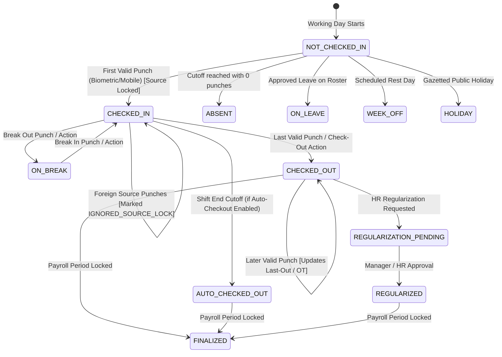

# JOY PeopleHR — Attendance State Machine

## 1. Lifecycle State Machine Diagram

---

## 2. State Invariants

1. **`NOT_CHECKED_IN`**:
   - `first_in_at = null`, `last_out_at = null`, `active_source = null`.
   - Mobile UI shows `[ Clock In Now ]`.
2. **`CHECKED_IN`**:
   - `first_in_at = ISO Timestamp`, `active_source = BIOMETRIC | MOBILE`.
   - `is_source_locked = true`.
   - Mobile live timer runs dynamically: `now() - first_in_at`.
   - Mobile UI shows `● Checked In` with live second counter.
3. **`CHECKED_OUT`**:
   - `last_out_at = ISO Timestamp`.
   - `net_work_minutes`, `late_minutes`, `early_minutes`, and `overtime_minutes` computed.
   - Mobile live timer stops.
4. **`AUTO_CHECKED_OUT`**:
   - Closed by system worker at shift cutoff with `check_out_source = SYSTEM`, `check_out_method = AUTO`.
