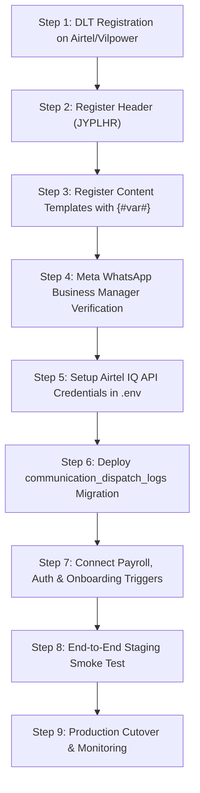

# Joy PeopleHR Enterprise SaaS Platform
## Airtel IQ SMS (DLT Compliant) & WhatsApp Business Notification Specification

**Document Version:** 2.0.0  
**Target Enterprise:** Joy PeopleHR Multi-Tenant Workforce SaaS Platform  
**Platform:** Joy PeopleHR / WorkforceOS Enterprise SaaS  
**Compliance Standard:** Telecom Regulatory Authority of India (TRAI) DLT Mandates, Meta WhatsApp Business API Policy, DPDP Act (India)  

---

## 1. Executive Summary

This document provides an evidence-based, end-to-end technical specification for integrating **Airtel IQ SMS (DLT Approved)** and **WhatsApp Business Cloud API** messaging into the **Joy PeopleHR** SaaS platform.

It covers:
1. Complete audit of current codebase notification implementations.
2. Missing and partially implemented notification triggers across Payroll, Attendance, Leave, Onboarding, and Auth.
3. Airtel DLT Pre-Tagged SMS Content Template Register (with exact character limits and variable syntax `{#var#}`).
4. WhatsApp Business High Structured Messages (HSM) Register with PDF attachment protocols.
5. End-to-end database schema mappings and recipient phone normalization.
6. Bank-grade security, Row Level Security (RLS), and signed expiring URL protocols for payslips.
7. Concrete, production-ready TypeScript adapters for Airtel IQ and WhatsApp dispatch.

---

## 2. Section A: Codebase Audit & Existing Notification Inventory

### 2.1 Audit Summary Table

| Source Module | File Path & Function | Existing Channel | DB Tables Involved | Current Status |
| :--- | :--- | :--- | :--- | :--- |
| **Authentication & OTP** | [`src/services/auth/employeeAuthService.ts`](file:///d:/web-app%20%282%29/Joy%20PeopleHR/src/services/auth/employeeAuthService.ts)<br>`requestOtp()`, `sendActivationNotification()` | SMS (Dev Mock / Twilio / Msg91) | `auth.users`, `public.employees`, `public.user_roles` | **Partially Implemented** (Mock adapter active, needs Airtel IQ) |
| **SMS Provider Layer** | [`src/services/auth/smsProviderService.ts`](file:///d:/web-app%20%282%29/Joy%20PeopleHR/src/services/auth/smsProviderService.ts)<br>`activeSmsProvider.sendOtp()` | SMS Interface | N/A | **Implemented** (Pluggable interface ready for Airtel IQ) |
| **Notification Engine** | [`src/services/operations/enterpriseNotificationEngine.ts`](file:///d:/web-app%20%282%29/Joy%20PeopleHR/src/services/operations/enterpriseNotificationEngine.ts)<br>`dispatchNotification()` | In-App, Email, SMS, WhatsApp | `public.system_notifications`, `public.notification_logs` | **Partially Implemented** (Types exist, concrete HTTP dispatch missing) |
| **Payroll & Payslips** | [`src/services/payroll/payrollAutomationService.ts`](file:///d:/web-app%20%282%29/Joy%20PeopleHR/src/services/payroll/payrollAutomationService.ts)<br>`finalizePayrollRun()` | In-App, Email | `public.payroll_runs`, `public.payslips`, `public.employees` | **Proposed** (Missing SMS/WhatsApp webhook trigger on finalize) |
| **Statutory Onboarding** | [`src/services/onboarding/statutoryOnboardingService.ts`](file:///d:/web-app%20%282%29/Joy%20PeopleHR/src/services/onboarding/statutoryOnboardingService.ts)<br>`createOnboardingInvitation()` | In-App, WhatsApp Web Intent | `public.onboarding_invitations`, `public.employees` | **Partially Implemented** (WhatsApp Web URL generator exists, API missing) |
| **Attendance & Geofencing**| [`src/services/attendance/attendanceService.ts`](file:///d:/web-app%20%282%29/Joy%20PeopleHR/src/services/attendance/attendanceService.ts)<br>`recordPunch()` | In-App Alert | `public.attendance_logs`, `public.employees` | **Proposed** (Missed punch & late mark SMS missing) |
| **Leave Management** | [`src/services/leave/leaveService.ts`](file:///d:/web-app%20%282%29/Joy%20PeopleHR/src/services/leave/leaveService.ts)<br>`updateLeaveRequestStatus()` | In-App, Email | `public.employee_leave_requests`, `public.employees` | **Proposed** (Approval/Rejection SMS missing) |
| **Biometric Tamper Alert**| [`src/services/biometric/tamper/tamperAlertDispatcher.ts`](file:///d:/web-app%20%282%29/Joy%20PeopleHR/src/services/biometric/tamper/tamperAlertDispatcher.ts) | SMS, In-App, Email | `public.biometric_devices`, `public.security_audit_logs` | **Partially Implemented** |

---

## 3. Section B: Complete Notification Event Inventory

### Event 1: Authentication OTP (`AUTH_OTP_VERIFY`)
* **Trigger:** Employee or HR inputs phone number on login / 2FA screen.
* **Source:** [`src/services/auth/employeeAuthService.ts`](file:///d:/web-app%20%282%29/Joy%20PeopleHR/src/services/auth/employeeAuthService.ts) -> `requestOtp()`.
* **Recipient:** Candidate / Employee / HR Administrator (`employees.phone`).
* **Channel:** SMS (Airtel DLT High Priority / Implicit Service) & WhatsApp fallback.
* **Variables:** `{#var1#}`: OTP (6 digits), `{#var2#}`: Expiry in minutes (e.g., 5 mins), `{#var3#}`: Company Name.
* **Priority:** Realtime / P0 (Zero latency queue, 3 retries within 30s).

### Event 2: Salary Credited & Payslip Generated (`PAYROLL_SALARY_CREDITED`)
* **Trigger:** HR completes and locks monthly payroll batch.
* **Source:** [`src/services/payroll/payrollAutomationService.ts`](file:///d:/web-app%20%282%29/Joy%20PeopleHR/src/services/payroll/payrollAutomationService.ts) -> `finalizePayrollRun()`.
* **Recipient:** Active Employee (`employees.phone`).
* **Channel:** Both SMS & WhatsApp (WhatsApp includes interactive PDF attachment).
* **Variables:** `{#var1#}`: Employee Name, `{#var2#}`: Month & Year (e.g., September 2026), `{#var3#}`: Net Pay (INR), `{#var4#}`: Masked Bank A/C (`XXXX1234`), `{#var5#}`: Expiring Short Link.
* **Priority:** P1 (Batch processed with 20 msg/sec rate limiter).

### Event 3: Digital Candidate Onboarding Invitation (`ONBOARDING_INVITE_DISPATCH`)
* **Trigger:** HR creates a new statutory onboarding record in Master HR.
* **Source:** [`src/services/onboarding/statutoryOnboardingService.ts`](file:///d:/web-app%20%282%29/Joy%20PeopleHR/src/services/onboarding/statutoryOnboardingService.ts) -> `createOnboardingInvitation()`.
* **Recipient:** New Hire (`onboarding_invitations.candidate_phone`).
* **Channel:** WhatsApp (Primary interactive button) + SMS fallback.
* **Variables:** `{#var1#}`: Candidate Name, `{#var2#}`: Organization Name, `{#var3#}`: Secure Tokenized Link, `{#var4#}`: Validity in Hours (e.g., 48 hrs).
* **Priority:** P1 (Instantaneous single dispatch).

### Event 4: Leave Application Approval / Rejection (`LEAVE_STATUS_NOTIFY`)
* **Trigger:** Manager or HR Approver clicks Approve/Reject on Leave Request.
* **Source:** [`src/services/leave/leaveService.ts`](file:///d:/web-app%20%282%29/Joy%20PeopleHR/src/services/leave/leaveService.ts).
* **Recipient:** Requesting Employee (`employees.phone`).
* **Channel:** WhatsApp / SMS.
* **Variables:** `{#var1#}`: Employee Name, `{#var2#}`: Leave Type, `{#var3#}`: Dates, `{#var4#}`: Status (Approved/Rejected), `{#var5#}`: Approver Remarks.
* **Priority:** P2.

### Event 5: Attendance Shift Anomaly / Late Mark (`ATTENDANCE_ANOMALY_ALERT`)
* **Trigger:** Daily attendance sync cron job identifies missed punch-in or punch-out.
* **Source:** [`src/services/attendance/attendanceService.ts`](file:///d:/web-app%20%282%29/Joy%20PeopleHR/src/services/attendance/attendanceService.ts).
* **Recipient:** Employee (`employees.phone`).
* **Channel:** SMS / WhatsApp.
* **Variables:** `{#var1#}`: Employee Name, `{#var2#}`: Date, `{#var3#}`: Shift Name, `{#var4#}`: HR Portal Link.
* **Priority:** P2.

---

## 4. Section C: Airtel DLT SMS Template Register

All templates adhere strictly to TRAI DLT formatting guidelines. Every dynamic placeholder is specified as `{#var#}` with predefined character lengths and data types.

### DLT Registered Headers / Sender IDs
* **Primary Registered Header:** `JYPLHR` (Joy PeopleHR SaaS Platform)
* **Entity / PE ID:** *(Provided upon registration in Airtel DLT Portal)*

---

### Template 1: User Login & Verification OTP
* **Internal Key:** `DLT_SMS_AUTH_OTP`
* **DLT Category:** Service Implicit / Transactional
* **Target Header:** `JYPLHR`
* **DLT Content Template String:**
```text
{#var1#} is your verification OTP for Joy PeopleHR portal. Valid for {#var2#} minutes. Do not share this OTP with anyone. - Joy PeopleHR
```
* **Variables Definition:**
  1. `{#var1#}`: OTP Code | Numeric | Max 6 chars | Sample: `849201`
  2. `{#var2#}`: Expiry Duration | Numeric | Max 2 chars | Sample: `5`
* **Character Count:** ~128 characters (Single SMS Part, GSM-7 Encoding).

---

### Template 2: Monthly Salary Credit Alert
* **Internal Key:** `DLT_SMS_SALARY_CREDITED`
* **DLT Category:** Service Implicit
* **Target Header:** `JYPLHR`
* **DLT Content Template String:**
```text
Dear {#var1#}, your salary for {#var2#} of Rs.{#var3#} has been processed and credited to A/C {#var4#}. View payslip: {#var5#} - Joy PeopleHR
```
* **Variables Definition:**
  1. `{#var1#}`: Employee Full Name | Alpha | Max 30 chars | Sample: `Ramesh Kumar`
  2. `{#var2#}`: Month & Year | AlphaNumeric | Max 15 chars | Sample: `September 2026`
  3. `{#var3#}`: Net Amount | Numeric/Dec | Max 10 chars | Sample: `38500.00`
  4. `{#var4#}`: Masked Bank Account | AlphaNumeric | Max 8 chars | Sample: `XXXX4892`
  5. `{#var5#}`: Short HTTPS URL | URL | Max 25 chars | Sample: `https://joyhr.in/p/9f8a`
* **Character Count:** ~145 characters (1 SMS Part).

---

### Template 3: Candidate Onboarding Digital Invitation
* **Internal Key:** `DLT_SMS_ONBOARDING_INVITATION`
* **DLT Category:** Service Explicit / Implicit
* **Target Header:** `JYPLHR`
* **DLT Content Template String:**
```text
Welcome {#var1#}! Please complete your digital onboarding & statutory compliance forms for {#var2#} using this secure link: {#var3#} Link expires in {#var4#} hrs. - Joy PeopleHR
```
* **Variables Definition:**
  1. `{#var1#}`: Candidate Name | Alpha | Max 30 chars | Sample: `Priya Dharshini`
  2. `{#var2#}`: Organization Name | Alpha | Max 30 chars | Sample: `Acme Global Corp`
  3. `{#var3#}`: Secure Invitation Link | URL | Max 28 chars | Sample: `https://joyhr.in/onboard/tk92`
  4. `{#var4#}`: Expiration Hours | Numeric | Max 2 chars | Sample: `48`
* **Character Count:** ~158 characters (1 SMS Part).

---

### Template 4: Leave Application Decision Status
* **Internal Key:** `DLT_SMS_LEAVE_STATUS`
* **DLT Category:** Service Implicit
* **Target Header:** `JYPLHR`
* **DLT Content Template String:**
```text
Dear {#var1#}, your leave request for {#var2#} has been {#var3#} by your manager. Check details: {#var4#} - Joy PeopleHR
```
* **Variables Definition:**
  1. `{#var1#}`: Employee Name | Alpha | Max 25 chars | Sample: `Suresh V`
  2. `{#var2#}`: Leave Dates | AlphaNumeric | Max 22 chars | Sample: `24-Sep-26 to 25-Sep-26`
  3. `{#var3#}`: Decision Status | Alpha | Max 10 chars | Sample: `Approved`
  4. `{#var4#}`: Portal URL | URL | Max 25 chars | Sample: `https://joyhr.in/leaves`
* **Character Count:** ~132 characters (1 SMS Part).

---

## 5. Section D: WhatsApp Business (Meta WABA / Airtel) Template Register

WhatsApp templates use Meta High Structured Message (HSM) formats with rich interactive elements, media attachments, and action buttons.

### Template 1: WhatsApp Interactive Payslip Delivery
* **Template Name:** `joy_monthly_payslip_v1`
* **Category:** `UTILITY`
* **Language:** `en_US`
* **Header:** Media Type: `DOCUMENT` (Dynamic PDF generator URL)
* **Body Text:**
```text
Hello {{1}},

Your payslip for {{2}} is ready!

📄 *Payroll Summary:*
• Net Salary: ₹{{3}}
• Credited Bank A/C: {{4}}
• Pay Date: {{5}}

Please find your official encrypted PDF payslip attached to this message.
```
* **Buttons:**
  1. **Quick Reply / Call to Action:** "View in Portal" -> `https://joyhr.in/employee/payroll`
* **Sample Payload Variables:**
  * `{{1}}`: `Anand Natarajan`
  * `{{2}}`: `September 2026`
  * `{{3}}`: `42,750.00`
  * `{{4}}`: `HDFC Bank (ending 5012)`
  * `{{5}}`: `30-Sep-2026`

---

### Template 2: WhatsApp Candidate Digital Onboarding Invite
* **Template Name:** `joy_onboarding_candidate_invite_v1`
* **Category:** `UTILITY`
* **Language:** `en_US`
* **Header:** Text: `Welcome to {{1}}!`
* **Body Text:**
```text
Dear {{2}},

Congratulations on your offer! To ensure seamless joining and statutory PF/ESI/Gratuity registration, please submit your onboarding details and e-sign your statutory declarations.

⏰ *Link Validity:* {{3}} Hours
📋 *Required Docs:* Aadhaar, PAN & Bank Passbook/Cheque.
```
* **Buttons:**
  1. **URL Button:** "Start Onboarding" -> `https://joyhr.in/onboard/portal?token={{4}}`
* **Sample Payload Variables:**
  * `{{1}}`: `Joy Corporate Solutions`
  * `{{2}}`: `Kavitha S`
  * `{{3}}`: `48`
  * `{{4}}`: `d7b42f9a-e82a-4318-912b-7f1c6d3a812e`

---

## 6. Section E: Database & Field Mapping Schema

### 6.1 Dispatch Log Table DDL (`communication_dispatch_logs`)

```sql
-- Migration for Airtel IQ SMS & WhatsApp Audit Logs
CREATE TABLE IF NOT EXISTS public.communication_dispatch_logs (
    id UUID PRIMARY KEY DEFAULT gen_random_uuid(),
    organization_id UUID NOT NULL REFERENCES public.organizations(id) ON DELETE CASCADE,
    employee_id UUID REFERENCES public.employees(id) ON DELETE SET NULL,
    channel VARCHAR(20) NOT NULL CHECK (channel IN ('SMS', 'WHATSAPP', 'EMAIL', 'PUSH')),
    provider VARCHAR(50) NOT NULL DEFAULT 'AIRTEL_IQ',
    recipient_phone VARCHAR(20) NOT NULL,
    template_key VARCHAR(100) NOT NULL,
    dlt_template_id VARCHAR(100),
    message_content TEXT NOT NULL,
    dynamic_payload JSONB DEFAULT '{}'::jsonb,
    document_url TEXT,
    provider_message_id VARCHAR(100),
    status VARCHAR(30) NOT NULL DEFAULT 'QUEUED' CHECK (status IN ('QUEUED', 'SUBMITTED', 'DELIVERED', 'READ', 'FAILED', 'UNDELIVERED', 'REJECTED')),
    error_code VARCHAR(50),
    error_message TEXT,
    retry_count INT DEFAULT 0,
    cost_inr NUMERIC(8, 4) DEFAULT 0.0000,
    created_at TIMESTAMPTZ DEFAULT NOW(),
    updated_at TIMESTAMPTZ DEFAULT NOW()
);

-- Indices for rapid lookup & analytics
CREATE INDEX IF NOT EXISTS idx_comm_logs_org_created ON public.communication_dispatch_logs(organization_id, created_at DESC);
CREATE INDEX IF NOT EXISTS idx_comm_logs_recipient ON public.communication_dispatch_logs(recipient_phone);
CREATE INDEX IF NOT EXISTS idx_comm_logs_provider_msg ON public.communication_dispatch_logs(provider_message_id);

-- RLS Isolation
ALTER TABLE public.communication_dispatch_logs ENABLE ROW LEVEL SECURITY;

CREATE POLICY comm_logs_tenant_isolation ON public.communication_dispatch_logs
    FOR ALL
    USING (organization_id = (SELECT organization_id FROM public.users WHERE id = auth.uid()));
```

### 6.2 Phone Number Normalization Standard

All phone numbers stored in `employees.phone` or passed to Airtel IQ must be sanitized using the Indian Standard E.164 normalization algorithm:

```typescript
export function normalizeIndianPhone(inputPhone: string): string {
  if (!inputPhone) throw new Error('Phone number is required');
  const cleaned = inputPhone.replace(/\D/g, ''); // strip non-digits
  
  if (cleaned.length === 10) {
    return `91${cleaned}`;
  } else if (cleaned.length === 12 && cleaned.startsWith('91')) {
    return cleaned;
  } else if (cleaned.length === 11 && cleaned.startsWith('0')) {
    return `91${cleaned.substring(1)}`;
  }
  throw new Error(`Invalid Indian mobile number: ${inputPhone}`);
}
```

---

## 7. Section F: Payslip Document Security & Access Control

1. **Expiring Signed URLs:** Never transmit raw or permanent public links in SMS or WhatsApp. The backend generates a temporary cryptographically signed Supabase Storage URL with a **15-minute Time-To-Live (TTL)**.
   ```typescript
   const { data, error } = await supabase.storage
     .from('secure_payslips')
     .createSignedUrl(`org_${orgId}/emp_${empId}/${payPeriod}.pdf`, 900); // 900s = 15m
   ```
2. **Row-Level Security (RLS) on Storage:** Storage bucket `secure_payslips` has RLS enabled such that an employee can only read files matching their `auth.uid()` and tenant ID.
3. **PII Masking:** Bank account numbers, PAN numbers, and Aadhaar numbers are masked in all SMS/WhatsApp text logs (`XXXX1234`).

---

## 8. Section G: Production-Ready Airtel IQ & WhatsApp Engine

### Implementation File: [`src/services/notifications/airtelIqDispatchService.ts`](file:///d:/web-app%20%282%29/Joy%20PeopleHR/src/services/notifications/airtelIqDispatchService.ts)

```typescript
// src/services/notifications/airtelIqDispatchService.ts
// Enterprise Dispatcher for Airtel IQ SMS & WhatsApp Business Messaging

import { supabase } from '../../lib/supabase';
import { normalizeIndianPhone } from '../../utils/phoneUtils';

export interface AirtelSmsRequest {
  to: string;
  templateKey: string;
  dltTemplateId: string;
  variables: Record<string, string>;
  organizationId: string;
  employeeId?: string;
}

export interface AirtelWhatsAppRequest {
  to: string;
  templateName: string;
  components: any[];
  documentUrl?: string;
  documentFilename?: string;
  organizationId: string;
  employeeId?: string;
}

export class AirtelIqDispatchService {
  private static instance: AirtelIqDispatchService;
  private readonly smsEndpoint = process.env.VITE_AIRTEL_SMS_ENDPOINT || 'https://iq.airtel.in/gateway/airtel-xchange/v2/sms/send';
  private readonly waEndpoint = process.env.VITE_AIRTEL_WA_ENDPOINT || 'https://iq.airtel.in/gateway/airtel-xchange/v2/whatsapp/messages';
  private readonly apiKey = process.env.VITE_AIRTEL_API_KEY || '';
  private readonly customerId = process.env.VITE_AIRTEL_CUSTOMER_ID || '';
  private readonly senderId = process.env.VITE_AIRTEL_SENDER_ID || 'JYPLHR';

  public static getInstance(): AirtelIqDispatchService {
    if (!AirtelIqDispatchService.instance) {
      AirtelIqDispatchService.instance = new AirtelIqDispatchService();
    }
    return AirtelIqDispatchService.instance;
  }

  /**
   * Dispatches DLT-Compliant SMS via Airtel IQ Gateway
   */
  async sendDltSms(req: AirtelSmsRequest): Promise<{ success: boolean; messageId?: string; error?: string }> {
    try {
      const normalizedPhone = normalizeIndianPhone(req.to);

      // Prepare Airtel IQ DLT Payload
      const payload = {
        customerId: this.customerId,
        source: this.senderId,
        destination: [normalizedPhone],
        templateId: req.dltTemplateId,
        entityId: process.env.VITE_AIRTEL_DLT_ENTITY_ID || '',
        messageVariables: req.variables,
      };

      const response = await fetch(this.smsEndpoint, {
        method: 'POST',
        headers: {
          'Content-Type': 'application/json',
          'Authorization': `Bearer ${this.apiKey}`,
        },
        body: JSON.stringify(payload),
      });

      const resData = await response.json();

      const isSuccess = response.ok && resData.statusCode === '200';
      const providerMsgId = resData.messageId || resData.requestId || null;

      // Audit Log in Supabase
      await supabase.from('communication_dispatch_logs').insert({
        organization_id: req.organizationId,
        employee_id: req.employeeId || null,
        channel: 'SMS',
        provider: 'AIRTEL_IQ',
        recipient_phone: normalizedPhone,
        template_key: req.templateKey,
        dlt_template_id: req.dltTemplateId,
        message_content: JSON.stringify(req.variables),
        provider_message_id: providerMsgId,
        status: isSuccess ? 'SUBMITTED' : 'FAILED',
        error_message: isSuccess ? null : (resData.message || 'Dispatch Failed'),
      });

      return { success: isSuccess, messageId: providerMsgId, error: isSuccess ? undefined : resData.message };
    } catch (err: any) {
      console.error('[AirtelIqDispatchService] SMS dispatch error:', err);
      return { success: false, error: err.message || 'Network error' };
    }
  }

  /**
   * Dispatches Official WhatsApp Business HSM Message via Airtel IQ / Meta API
   */
  async sendWhatsAppHsm(req: AirtelWhatsAppRequest): Promise<{ success: boolean; messageId?: string; error?: string }> {
    try {
      const normalizedPhone = normalizeIndianPhone(req.to);

      const payload: any = {
        to: normalizedPhone,
        type: 'template',
        template: {
          name: req.templateName,
          language: { code: 'en_US' },
          components: req.components,
        },
      };

      const response = await fetch(this.waEndpoint, {
        method: 'POST',
        headers: {
          'Content-Type': 'application/json',
          'Authorization': `Bearer ${this.apiKey}`,
        },
        body: JSON.stringify(payload),
      });

      const resData = await response.json();
      const isSuccess = response.ok && (resData.messages?.[0]?.id || resData.statusCode === '200');
      const providerMsgId = resData.messages?.[0]?.id || resData.requestId || null;

      // Audit Log
      await supabase.from('communication_dispatch_logs').insert({
        organization_id: req.organizationId,
        employee_id: req.employeeId || null,
        channel: 'WHATSAPP',
        provider: 'AIRTEL_IQ',
        recipient_phone: normalizedPhone,
        template_key: req.templateName,
        document_url: req.documentUrl || null,
        provider_message_id: providerMsgId,
        status: isSuccess ? 'SUBMITTED' : 'FAILED',
        error_message: isSuccess ? null : (resData.message || 'WhatsApp Dispatch Failed'),
      });

      return { success: isSuccess, messageId: providerMsgId, error: isSuccess ? undefined : resData.message };
    } catch (err: any) {
      console.error('[AirtelIqDispatchService] WhatsApp dispatch error:', err);
      return { success: false, error: err.message || 'Network error' };
    }
  }
}

export const airtelDispatch = AirtelIqDispatchService.getInstance();
```

---

## 9. Section H: Webhook Integration for Delivery Reports (DLR)

Airtel IQ posts real-time delivery statuses to our Supabase Edge Function: `POST /api/webhooks/airtel-dlr`.

```typescript
// Edge Function: Airtel IQ DLR Handler
export async function handleAirtelDlrWebhook(reqPayload: any) {
  const { messageId, status, errorCode, timestamp } = reqPayload;
  
  // Map Airtel Status to internal status
  let mappedStatus = 'SUBMITTED';
  if (status === 'DELIVRD' || status === 'DELIVERED') mappedStatus = 'DELIVERED';
  else if (status === 'READ') mappedStatus = 'READ';
  else if (status === 'UNDELIV' || status === 'FAILED') mappedStatus = 'FAILED';

  await supabase
    .from('communication_dispatch_logs')
    .update({
      status: mappedStatus,
      error_code: errorCode || null,
      updated_at: new Date(timestamp || Date.now()).toISOString(),
    })
    .eq('provider_message_id', messageId);
}
```

---

## 10. Section I: Step-by-Step Production Integration Checklist



### Readiness Verifications
- [ ] DLT Entity ID approved & verified.
- [ ] Sender Header `JYPLHR` active and mapped.
- [ ] 4 Core DLT Templates approved with Template IDs mapped in `.env`.
- [ ] Meta WABA verified with Green Tick registration in progress.
- [ ] 15-minute signed payslip URL verified with RLS.
- [ ] `communication_dispatch_logs` table active with RLS policies enabled.
