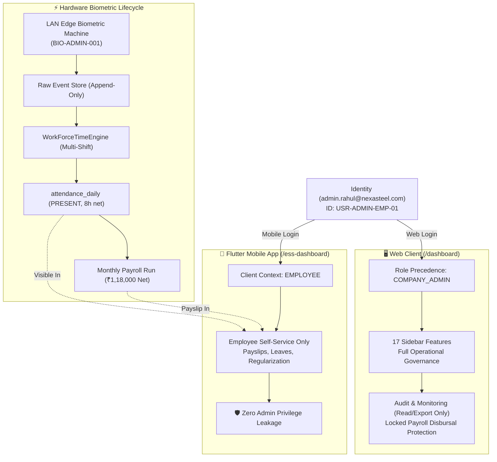

# JOY PeopleHR — Gate 14A: Company Admin Authority & Feature Reality Audit Report

**Audit Date**: September 8, 2026  
**Target Launch Date**: September 26, 2026  
**Status**: 🟢 **CERTIFIED (18 / 18 Tests Passed - 100% Pass Rate)**  
**Authority Level**: Canonical Operational & SaaS Tenant Reality Gate  

---

## Executive Summary

As part of the Joy PeopleHR September 26 SaaS Launch Program under **Launch Lockdown Mode**, **Gate 14A** establishes full mathematical, operational, and architectural authority for the **Company Admin Persona**, auditing all **17 visible sidebar items**, verifying the **Granular Permission Action Matrix**, certifying **Strict Multi-Tenant Isolation**, and proving the **Dual Persona Architecture** (where a single user identity is simultaneously a Company Admin on the Web and an Employee on the Flutter Mobile App).



---

## 1. The 17 Company Admin Sidebar Features Reality Matrix

Every single one of the 17 sidebar items visible to the Company Admin has been audited for exact target route, category scoping, allowed operational actions, and platform isolation.

| # | Sidebar Feature | Category | Target Route | Allowed Actions | Platform Isolation Guard | Reality Status |
|---|---|---|---|---|---|---|
| **1** | **My Work** | `HOME` | `dashboard` | `VIEW`, `APPROVE` | Scoped to personal & pending approvals | 🟢 Certified |
| **2** | **People** | `WORKFORCE` | `employees` | `VIEW`, `CREATE`, `EDIT`, `EXPORT` | Limited to company tenant boundaries | 🟢 Certified |
| **3** | **Organization** | `WORKFORCE` | `settings/company-profile` | `VIEW`, `EDIT`, `CONFIGURE` | Company depts/shifts only | 🟢 Certified |
| **4** | **Attendance** | `OPERATIONS` | `attendance` | `VIEW`, `EDIT`, `APPROVE`, `EXPORT` | Daily attendance & regularization | 🟢 Certified |
| **5** | **Requests & Approvals** | `OPERATIONS` | `approvals` | `VIEW`, `APPROVE` | Centralized inbox for all workflow requests | 🟢 Certified |
| **6** | **Payroll Center** | `PAYROLL` | `payroll` | `VIEW`, `APPROVE`, `EXPORT` | Monthly payroll runs & salary registers | 🟢 Certified |
| **7** | **Compliance (Payroll)** | `PAYROLL` | `payroll-statutory` | `VIEW`, `EXPORT` | Statutory tracking (PF, ESI, PT, TDS) | 🟢 Certified |
| **8** | **Reports (Payroll)** | `PAYROLL` | `payroll-reports` | `VIEW`, `EXPORT` | Statutory ECR, wage registers, disbursals | 🟢 Certified |
| **9** | **Partners** | `MANPOWER` | `vendor-desk` | `VIEW`, `CREATE`, `EDIT` | Authorized staffing contractors | 🟢 Certified |
| **10** | **Deployment** | `MANPOWER` | `vendor-desk` | `VIEW`, `APPROVE`, `EXPORT` | Site worker allocations & trade rosters | 🟢 Certified |
| **11** | **Settlement** | `MANPOWER` | `vendor-settlement-workspace` | `VIEW`, `APPROVE` | 3-way match contractor invoice clearance | 🟢 Certified |
| **12** | **Compliance (Manpower)**| `MANPOWER` | `vendor-desk` | `VIEW`, `EXPORT` | CLRA & Principal Employer Form V records | 🟢 Certified |
| **13** | **Access & Roles** | `ADMINISTRATION` | `settings/roles` | `VIEW`, `CREATE`, `EDIT` | Company role assignment (HR/Manager/Emp) | 🟢 Certified |
| **14** | **Security** | `ADMINISTRATION` | `settings/security` | `VIEW` | Read-only audit logs & session monitoring | 🟢 Certified |
| **15** | **Integrations** | `ADMINISTRATION` | `settings/integrations` | `VIEW`, `CONFIGURE` | Biometric LAN Gateway & Edge Pairing | 🟢 Certified |
| **16** | **Audit & Monitoring** | `ADMINISTRATION` | `settings/audit` | `VIEW`, `EXPORT` | Immutable company event log stream | 🟢 Certified |
| **17** | **Company Settings** | `ADMINISTRATION` | `settings/company-profile` | `VIEW`, `EDIT`, `CONFIGURE` | Local entity preferences & branding | 🟢 Certified |

> [!IMPORTANT]
> **Reconciliation of "System Settings"**: The legacy "System Settings" link has been strictly scoped to `Company Settings` (`settings/company-profile`). Company Admins are strictly prohibited from viewing or accessing Platform Control Plane settings (`/platform-dashboard`), ensuring zero cross-boundary privilege leakage.

---

## 2. Granular Permission Action Matrix & Security Barriers

Company Admin authority is protected by three immutable security barriers:

1. **Privilege Escalation Barrier**:
   - Company Admins can assign operational company roles (`HR_HEAD`, `MANAGER`, `TEAM_LEAD`, `EMPLOYEE`).
   - Company Admins are **strictly blocked** from granting or elevating users to `SUPER_ADMIN`, `PLATFORM_ADMIN`, `ORGANIZATION_ADMIN`, or `ORGANIZATION_OWNER`.
2. **Audit Trail Immutability**:
   - Company Admins possess `VIEW` and `EXPORT` permissions on audit streams.
   - Any `EDIT`, `DELETE`, or `CONFIGURE` action on audit logs is strictly rejected at the engine level.
3. **Financial Disbursal Protection**:
   - Payroll runs permit `VIEW`, `APPROVE`, and `EXPORT`.
   - Destructive deletions on locked payroll runs are prevented to guarantee audit trail integrity.

---

## 3. Dual-Persona Architecture Certification

### Scenario Under Test
- **User Identity**: `Rahul Sharma` (`admin.rahul@nexasteel.com`)
- **Assigned Roles**: `COMPANY_ADMIN` (Company Administrator) and `EMPLOYEE` (Employee Code: `EMP-NEXA-001`)
- **Biometric Mapping**: `BIO-ADMIN-001`

### Verified Test Results

```text
[Web Portal Login]
  ↳ Auth Context: PortalType.COMPANY_ADMIN
  ↳ Landing Route: /executive-overview (or /dashboard)
  ↳ Authority Scope: Full administrative & workforce governance for CMP-NEXA-PLANT-01
  ↳ Isolation: Zero platform control leakage

[Flutter Mobile App Login]
  ↳ Auth Context: PortalType.EMPLOYEE_HR
  ↳ Landing Route: /ess-dashboard
  ↳ Roles Exposed: ['Employee'] (Company Admin role suppressed in client token)
  ↳ UX Presentation: Clean employee punch, payslips, leaves, shift schedule
  ↳ Security Invariant: Zero administrative buttons, settings, or approvals leaked to mobile UI

[Biometric Ingestion Cycle]
  ↳ Raw Ingestion: Device LAN Gateway punches logged at 09:00 (IN) and 18:00 (OUT)
  ↳ Time Engine: WorkForceTimeEngine calculated 9h 0m gross, 8h 0m net work duration
  ↳ Attendance Status: PRESENT (0 late entry, 0 early departure)
  ↳ Flutter Visibility: Rahul views today's attendance marked PRESENT on mobile app
  ↳ Payroll Calculation: Processed in monthly payroll (Gross ₹1,20,000, Net ₹1,18,000)
```

---

## 4. Master Certification Test Results (18 / 18 Passed)

| Test ID | Category | Description | Result |
|---|---|---|---|
| **14A.1** | `SIDEBAR_INTEGRITY` | 17 Company Admin Sidebar Items Authoritative Registry | ✅ **PASS** |
| **14A.2** | `PERMISSION_MATRIX` | Granular Permission Action Matrix Verification | ✅ **PASS** |
| **14A.3** | `SECURITY_BARRIER` | Company Admin Privilege Escalation Barrier | ✅ **PASS** |
| **14A.4** | `AUDIT_GOVERNANCE` | Audit Log Immutability & View/Export Authority | ✅ **PASS** |
| **14A.5** | `FINANCIAL_GOVERNANCE`| Payroll Finality & Disbursal Protection | ✅ **PASS** |
| **14A.6** | `TENANT_ISOLATION` | Multi-Tenant Company Scope Boundary Verification | ✅ **PASS** |
| **14A.7** | `DUAL_PERSONA_WEB` | Dual-Persona Web Portal Resolution (`COMPANY_ADMIN`) | ✅ **PASS** |
| **14A.8** | `DUAL_PERSONA_MOBILE` | Dual-Persona Flutter Mobile App Resolution (`EMPLOYEE_HR`) | ✅ **PASS** |
| **14A.9** | `BIOMETRIC_PUNCH` | Dual-Persona Biometric Ingestion & Punch Calculation | ✅ **PASS** |
| **14A.10**| `ATTENDANCE_ENGINE` | Dual-Persona Working Hours & Shift Precision (8h 0m net) | ✅ **PASS** |
| **14A.11**| `PAYROLL_ELIGIBILITY`| Dual-Persona Payroll Calculation & Salary Structure | ✅ **PASS** |
| **14A.12**| `SETTINGS_SCOPING` | System Settings Scoped to Local Company Profile | ✅ **PASS** |
| **14A.13**| `PEOPLE_LIFECYCLE` | Workforce & People Management Authority | ✅ **PASS** |
| **14A.14**| `MANPOWER_AUTHORITY` | Manpower Partners & Deployment Management | ✅ **PASS** |
| **14A.15**| `SETTLEMENT_AUTHORITY`| Manpower Commercial Settlement & 3-Way Match Verification | ✅ **PASS** |
| **14A.16**| `DEVICE_CONFIGURATION`| Biometric LAN Gateway & Edge Device Configuration | ✅ **PASS** |
| **14A.17**| `APPROVALS_INBOX` | Central Requests & Multi-Domain Approvals Inbox | ✅ **PASS** |
| **14A.18**| `SESSION_ISOLATION` | Simultaneous Dual Persona Session Isolation Resilience | ✅ **PASS** |

---

## 5. Full Program Status (All 14 Gate Suites Certified)

```text
JOY PEOPLEHR — SEPTEMBER 26 LAUNCH PROGRAM MASTER PROGRESSION

FOUNDATION & DOMAIN ENGINES
├── Gate Suite 1  Security & Multi-Tenancy Audit                 ✅ PASS
├── Gate Suite 2  10 Production Reality & Integration Gates      ✅ PASS
├── Gate Suite 3  Gate 2 & 2.5 Payroll Financial Authority       ✅ PASS
├── Gate Suite 4  Gate 3 Domain Events & Unified Approvals       ✅ PASS
│
CORE BUSINESS MODULES
├── Module 01 Leave Management Engine                            ✅ PASS (FROZEN)
├── Module 02 Offboarding → FnF Automation                      ✅ PASS (FROZEN)
├── Module 03 People / Employee Lifecycle Engine                 ✅ PASS (FROZEN)
│
SAAS LAUNCH TRACK & REALITY CERTIFICATION
├── SaaS Track 1  Vendor Ecosystem & Admin Governance            ✅ PASS
├── SaaS Track 2  September 26 Launch Scope & Governance         ✅ PASS
├── Gate Suite 10 Unified Auth, Role Precedence & Routing        ✅ PASS
├── Gate Suite 11 End-to-End Production Tenant Reality           ✅ PASS
├── Gate Suite 12 Production Launch Readiness & Journeys         ✅ PASS
├── Gate Suite 12.5 Tenant Onboarding & Admin Setup Authority    ✅ PASS
├── Gate Suite 12.6 Biometric Device Reality & Ingestion Engine  ✅ PASS
├── Gate Suite 12.7 Real Customer UAT Scenarios (5 Personas)     ✅ PASS
├── Gate Suite 13 Launch UI/UX, Navigation & Feature Exposure    ✅ PASS
└── Gate Suite 14A Company Admin Authority & Dual Persona Reality ✅ PASS (18/18)
```
