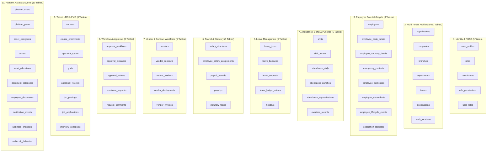
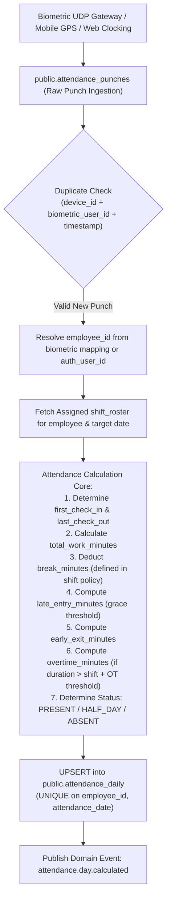
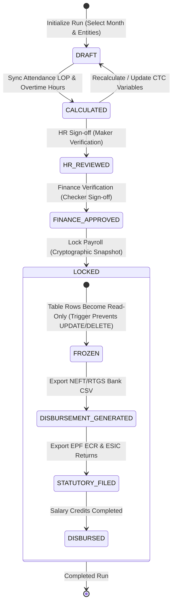
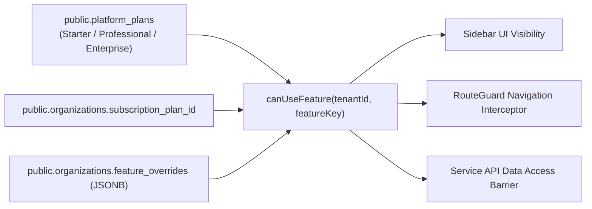
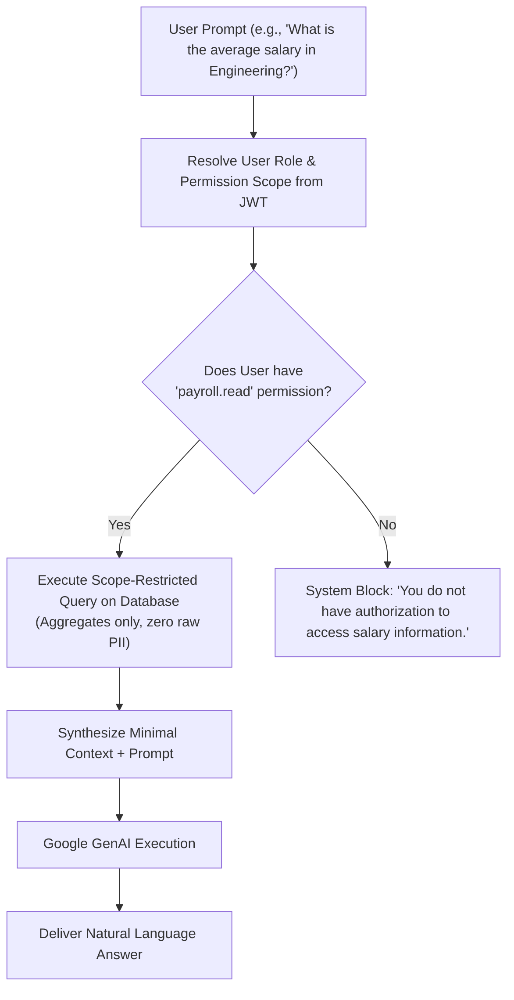
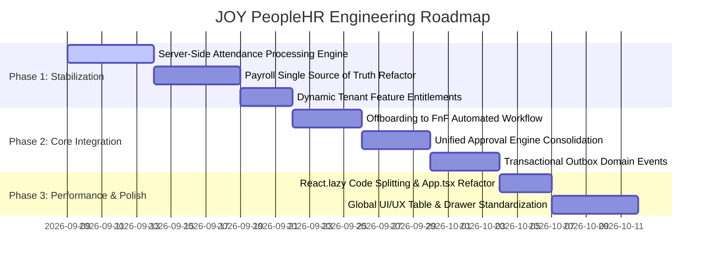

# JOY PeopleHR (WorkforceOS Enterprise) — Master Technical Blueprint
**Document Version:** 3.0  
**Status:** Authoritative Architectural Specification & Dependency Matrix  
**Target Repository:** `workforceos-enterprise-hrms` (`d:\web-app (2)\Joy PeopleHR`)  
**Database Target:** Canonical Supabase PostgreSQL (`ysiajemrqakfngasehhi.supabase.co`)  
**Date:** September 8, 2026  

---

## 1. Executive Architectural Vision: From "App" to "Workforce Operating System"

JOY PeopleHR is not a traditional CRUD HR tool. It is an enterprise **Workforce Operating System (WorkforceOS)** designed to serve 7 distinct personas across complex multi-entity corporate structures and third-party contract workforce ecosystems.

```text
                                JOY PEOPLEHR PLATFORM
                                          │
                      ┌───────────────────┴────────────────────┐
                      │                                        │
                CONTROL PLANE                           TENANT WORKSPACE
                      │                                        │
              ┌───────┼────────┐                     ┌─────────┼─────────┐
              │       │        │                     │         │         │
           Plans    Billing  Feature Flags         HR Core   Workforce  Finance
              │                                      │         │         │
              │                              ┌───────┼──────┐  │         │
              │                              │       │      │  │         │
              │                           People  Leave  Attendance      Payroll
              │                                      │      │              │
              └──────────────────────────────────────┼──────┼──────────────┘
                                                     │
                                              EVENT / WORKFLOW LAYER
                                                     │
                                  ┌──────────────────┼──────────────────┐
                                  │                  │                  │
                            Notifications        Approvals          Automation
                                  │                  │                  │
                            Email/Push/WA       Escalation        Scheduled Jobs
                                                     │
                                              INTEGRATION LAYER
                                                     │
                             Biometric / Flutter / APIs / BGV / DigiLocker
```

### The Core Architectural Tenet
> **Individual features are only as reliable as the contracts and handoffs between them.**  
> Code compilation (`tsc --noEmit = 0`) and UI rendering do not equal production readiness. True production readiness requires **authoritative backend single-source-of-truth, idempotent calculation engines, financial state immutability, and unified event-driven domain handoffs.**

---

## 2. Canonical 64 Database Tables Classified by Domain

The 64 deployed Greenfield tables in `ysiajemrqakfngasehhi` are partitioned into 10 strict domain boundaries:



---

## 3. Master Dependency Matrix: Data Contracts & Hand-offs

This matrix governs all data reading, writing, trigger emission, and prerequisite dependencies across all 22 modules:

| # | Module | Primary Reads From (Tables) | Primary Writes To (Tables) | Triggers Dispatched | Hard Depends On | Failure Impact if Broken |
|---|---|---|---|---|---|---|
| **1** | **Auth & Identity** | `auth.users`, `user_profiles`, `user_roles`, `roles` | `user_profiles`, `user_roles` | `auth.login`, `auth.password_changed`, `auth.session_revoked` | Supabase GoTrue Auth | Total system lockout; role crossover risk |
| **2** | **Dashboard / Command Center** | `employees`, `attendance_daily`, `leave_requests`, `approval_instances`, `vendors` | None (Read-only aggregator) | None | Core HR, Attendance, Approvals | Stale executive metrics, wrong pending counts |
| **3** | **People & Core HR** | `employees`, `departments`, `designations`, `branches` | `employees`, `employee_bank_details`, `employee_statutory_details`, `employee_addresses` | `employee.created`, `employee.updated`, `employee.transferred` | `organizations`, `companies` | Cascade failure across Payroll, Attendance & ESS |
| **4** | **Organization Arch** | `organizations`, `companies`, `branches`, `departments`, `work_locations` | `organizations`, `companies`, `branches`, `departments`, `work_locations` | `organization.updated`, `location.geofence_changed` | Multi-Tenant root | Broken geofencing, broken reporting hierarchies |
| **5** | **Onboarding** | `job_applications`, `document_requirements` | `employees`, `user_profiles`, `employee_documents` | `onboarding.stage_changed`, `employee.activated` | People Core, Identity | Candidate stuck; unable to issue login credentials |
| **6** | **Offboarding** | `employees`, `asset_allocations`, `leave_balances` | `separation_requests`, `employee_lifecycle_events` | `employee.separation_initiated`, `clearance.completed` | People Core, Assets, Leave | Ghost employees on payroll; unrecovered assets |
| **7** | **Document Vault** | `document_categories`, `employee_documents` | `employee_documents` | `document.uploaded`, `document.verified` | Storage Buckets | Compliance violation; audit disqualification |
| **8** | **Asset Management** | `asset_categories`, `assets`, `employees` | `assets`, `asset_allocations` | `asset.assigned`, `asset.returned` | People Core | Equipment leakage during exit |
| **9** | **Attendance Engine** | `attendance_punches`, `shifts`, `shift_rosters`, `work_locations` | `attendance_daily`, `overtime_records` | `attendance.day.calculated`, `attendance.late`, `attendance.absent` | Biometric Gateway, Shifts, Employees | Inaccurate salary payout; wrong LOP counts |
| **10** | **Regularization** | `attendance_daily`, `attendance_regularizations` | `attendance_regularizations`, `attendance_daily` | `regularization.submitted`, `regularization.approved` | Attendance Engine, Approvals | Over-deducted salary; employee disputes |
| **11** | **Leave Engine** | `leave_types`, `leave_balances`, `holidays` | `leave_requests`, `leave_balances`, `leave_ledger_entries` | `leave.requested`, `leave.approved`, `leave.lop_accrued` | Employees, Shifts, Approvals | Unapproved absences; financial balance mismatch |
| **12** | **Payroll Engine** | `employees`, `employee_salary_assignments`, `attendance_daily`, `leave_requests`, `overtime_records` | `payroll_periods`, `payslips`, `statutory_filings` | `payroll.calculated`, `payroll.locked`, `payroll.disbursed` | Attendance (LOP), Leave (LOP), Salary Structures | Financial loss, statutory PF/ESI fines, salary delays |
| **13** | **Full & Final (FnF)** | `separation_requests`, `leave_balances`, `asset_allocations`, `employee_salary_assignments` | `payslips` (`is_fnf = true`), `employee_lifecycle_events` | `fnf.drafted`, `fnf.approved`, `fnf.settled` | Offboarding, Payroll, Assets, Leave | Legal disputes with exited employees |
| **14** | **Vendor Manpower** | `vendors`, `vendor_contracts`, `vendor_workers`, `attendance_daily` | `vendor_deployments`, `vendor_invoices` | `vendor.invoice_submitted`, `vendor.match_verified` | Attendance Daily, Work Locations | Contractor over-billing; phantom worker payouts |
| **15** | **Client Billing** | `vendor_invoices`, `vendor_contracts`, `companies` | `public.invoices` / billing tables | `billing.generated`, `billing.paid` | Vendor Manpower | Revenue leakage on contractor margins |
| **16** | **Employee Self-Service** | Personal scoped employee records | Personal requests, clock-in punches | `punch.mobile_recorded`, `request.created` | User Profile Auth UID | Employee unable to clock in or see salary |
| **17** | **Team Lead Hub** | Team direct reports (`reporting_manager_id`) | Team task assignments, shift rosters | `task.assigned`, `team.roster_updated` | People Core, Attendance | Team coverage gaps; shift conflicts |
| **18** | **Unified Approvals** | `approval_workflows`, `approval_instances` | `approval_instances`, `approval_actions` | `approval.action_taken`, `approval.escalated` | Reporting Hierarchy, Domain Modules | Blocked operational workflows (Leave, OT, WFH) |
| **19** | **Recruitment (ATS)** | `job_postings`, `job_applications`, `interview_schedules` | `job_postings`, `job_applications`, `interview_schedules` | `candidate.hired`, `offer.accepted` | Organization Designations | Hiring pipeline stalls; manual data entry |
| **20** | **Performance (PMS)**| `goals`, `appraisal_cycles`, `appraisal_reviews` | `goals`, `appraisal_reviews` | `review.completed`, `rating.calibrated` | People Core, Org Hierarchy | Appraisal delays; disconnected salary revisions |
| **21** | **Learning (LMS)** | `courses`, `course_enrollments` | `course_enrollments` | `course.completed`, `certificate.issued` | People Core | Compliance violations (POSH, safety certifications) |
| **22** | **Admin Control Plane**| `platform_users`, `platform_plans`, `organizations` | `platform_plans`, `feature_flags`, `audit_logs` | `plan.updated`, `tenant.suspended` | Supabase Admin / Service Key | Multi-tenant billing and licensing failures |

---

## 4. End-to-End Core Business Lifecycles

### 4.1 The Complete Hire-to-Retire Lifecycle Pipeline
Every employee must traverse an orchestrated, event-driven pipeline where handoffs are system-enforced rather than human-remembered:

```mermaid
sequenceDiagram
    autonumber
    participant ATS as Recruitment (ATS)
    participant Onb as Onboarding Engine
    participant Core as People Core (DB)
    participant Auth as GoTrue Auth & RBAC
    participant Att as Attendance & Leave
    participant Pay as Payroll Engine
    participant Off as Offboarding Desk
    participant Asset as IT Asset Desk

    Note over ATS,Onb: 1. Candidate Transition
    ATS->>Onb: Emit candidate.hired (Candidate Dossier)
    Onb->>Core: Insert into employees (status = 'Onboarding')
    Onb->>Auth: Provision user_profiles + temporary password
    Onb->>Asset: Assign laptop & welcome kit in assets
    Onb->>Core: Onboarding documents verified -> status = 'Active'

    Note over Core,Pay: 2. Active Employment Lifecycle
    Core->>Att: Assign shift_roster + default leave_balances
    Core->>Pay: Assign employee_salary_assignments (CTC Structure)
    loop Every Month
        Att->>Pay: Feed net work hours + LOP days + overtime
        Pay->>Pay: Execute 4-Step Run (Draft -> Calculate -> Approve -> Lock)
        Pay-->>Core: Update monthly payslips + ledger
    end

    Note over Core,Off: 3. Separation & FnF Settlement
    Core->>Off: Resignation submitted -> separation_requests
    Off->>Asset: Trigger asset return clearance
    Asset-->>Off: All assets marked 'Returned'
    Off->>Att: Lock attendance on Last Working Day
    Off->>Pay: Emit employee.clearance.completed
    Pay->>Pay: Auto-calculate FnF Draft (Salary + Encashment - Recovery)
    Pay->>Core: Mark employee status = 'Exited' & revoke Auth session
```

---

## 5. Single Source of Truth Architecture (Zero LocalStorage for Business State)

### The Anti-Pattern
Previous iterations allowed operational engines (`payrollApi.ts`, `attendanceApi.ts`, `workOvertimeService.ts`) to read and write directly to `localStorage` when offline or on cache miss. This created **Split-Brain State**:
- User A on Device 1 edits a payroll draft; User B on Device 2 sees stale database values.
- Cache purges or incognito sessions erase attendance regularization queues.
- Biometric punches pushed to Supabase are invisible in the UI until local cache expires.

### The Immutable Rule
```text
                    ┌────────────────────────────────────────────────────────┐
                    │                   SUPABASE POSTGRES                    │
                    │               SOLE AUTHORITATIVE SOURCE                │
                    └───────────────────────────┬────────────────────────────┘
                                                │
                                    WAL Realtime Replication
                                                │
                                                ▼
                    ┌────────────────────────────────────────────────────────┐
                    │                 RealtimeSyncEngine                     │
                    │               Authoritative In-Memory                  │
                    │                   Domain Caches                        │
                    └───────────────────────────┬────────────────────────────┘
                                                │
                                                ▼
                    ┌────────────────────────────────────────────────────────┐
                    │                      UI Views                          │
                    │          (Optimistic Updates with Reversion)           │
                    └────────────────────────────────────────────────────────┘
```

#### Permitted LocalStorage Usage (Strictly Non-Authoritative):
1. UI theme (`dark` / `light`)
2. Sidebar collapsed state (`true` / `false`)
3. Table column visibility preferences and saved filter presets
4. Active route bookmark (`workforce_active_route`)

#### Prohibited LocalStorage Usage (Must Be 100% in Supabase):
- ❌ Payroll runs, component values, and lock states
- ❌ Attendance daily summaries, punches, and regularizations
- ❌ Leave requests, approval states, and balance ledgers
- ❌ Employee master records, salaries, and bank accounts
- ❌ Offboarding clearance statuses and FnF calculations

---

## 6. Server-Authoritative Attendance Processing Engine

### The Problem
Punches arrive at `public.attendance_punches` via edge biometric gateways, mobile GPS, or web clocking. Aggregating those punches into `public.attendance_daily` must **never** depend on client-side React code running upon user login.

### The Engine Specification
The attendance processor must be an **idempotent, server-side background engine** (Postgres trigger or Supabase Edge function) running on every punch insertion:



#### Idempotency Invariant:
Processing the exact same punch 1 time or 100 times must yield the exact same `attendance_daily` row. Punches arriving out of order (e.g., delayed sync from an offline biometric device) automatically trigger recalculation of that historical day.

---

## 7. Financial-Grade Payroll State Machine & Immutability

Payroll directly affects statutory filings, corporate bank accounts, and employee livelihoods. It must follow a strict **finite state machine with immutable history**:



### Immutability Invariant:
Once a payroll period enters `LOCKED`, a database trigger (`prevent_locked_payroll_mutation()`) blocks any `UPDATE` or `DELETE` on that period and its generated `payslips`. 
Any post-lock adjustments (such as retroactive pay rises or missed deductions) **cannot modify the locked run**. They must be queued as an **Adjustment Component in the subsequent payroll cycle**.

Every transition records an immutable audit log in `public.payroll_run_history`:
```sql
CREATE TABLE public.payroll_run_history (
    id UUID PRIMARY KEY DEFAULT gen_random_uuid(),
    payroll_period_id UUID NOT NULL REFERENCES public.payroll_periods(id),
    from_status VARCHAR(32) NOT NULL,
    to_status VARCHAR(32) NOT NULL,
    actor_id UUID NOT NULL REFERENCES auth.users(id),
    transition_metadata JSONB DEFAULT '{}'::jsonb,
    created_at TIMESTAMPTZ DEFAULT now()
);
```

---

## 8. Dynamic Feature Flag & Entitlement Architecture

### Current Debt in `src/components/shell/Sidebar.tsx`
Lines 1072–1076 hardcode modules to `false`:
```typescript
const isRecruitmentEnabledForTenant = false;
const isPerformanceEnabledForTenant = false;
const isLndEnabledForTenant = false;
const isAnalyticsEnabledForTenant = false;
const isTravelExpenseEnabledForTenant = false;
```

### The Required 3-Tier Entitlement Guard
Hiding menu items in the sidebar only masks the UI. A complete feature guard must protect all three tiers:
1. **UI Layer:** Sidebar and navigation hides unentitled features.
2. **Route Layer:** `RouteGuard.tsx` redirects direct URL navigation (e.g., `/recruitment`) to an informative Upgrade / Entitlement screen.
3. **API / Database Layer:** Supabase RLS and service calls verify tenant plan permissions before returning data.



---

## 9. Persistent Domain Event Architecture (`public.domain_events`)

Currently, `hrEventBus.ts` operates purely in browser RAM. If an event is dispatched while a user closes their tab or navigates away, the asynchronous side effect is lost.

### The Production Event Mesh:
All cross-module domain events must be persisted to `public.domain_events` using the **Transactional Outbox Pattern**:

```sql
CREATE TABLE public.domain_events (
    id UUID PRIMARY KEY DEFAULT gen_random_uuid(),
    organization_id UUID NOT NULL REFERENCES public.organizations(id),
    event_type VARCHAR(64) NOT NULL,
    aggregate_type VARCHAR(64) NOT NULL,
    aggregate_id VARCHAR(64) NOT NULL,
    payload JSONB NOT NULL DEFAULT '{}'::jsonb,
    actor_id UUID REFERENCES auth.users(id),
    status VARCHAR(32) DEFAULT 'PENDING' CHECK (status IN ('PENDING', 'PROCESSING', 'COMPLETED', 'FAILED')),
    retry_count INT DEFAULT 0,
    error_log TEXT,
    created_at TIMESTAMPTZ DEFAULT now(),
    processed_at TIMESTAMPTZ
);
CREATE INDEX idx_domain_events_status ON public.domain_events(status, created_at);
```

#### Core Domain Events:
- `employee.created` $\to$ Triggers Onboarding task checklist & asset allocation ticket.
- `attendance.day.calculated` $\to$ Updates live dashboard attendance rate & flags late penalties.
- `leave.approved` $\to$ Deducts leave ledger & updates shift roster availability.
- `separation.clearance_completed` $\to$ Auto-generates Draft FnF settlement in Payroll.
- `payroll.locked` $\to$ Generates encrypted employee PDF payslips & dispatches email notifications.

---

## 10. Multi-Tenant Isolation Architecture

Tenant safety is guaranteed across 3 independent, defense-in-depth layers:

```text
Layer 1: Database Schema Constraint
- Every tenant table MUST have an immutable "organization_id UUID NOT NULL".
- Foreign keys enforce parent organization integrity.

Layer 2: Row-Level Security (RLS)
- Every query evaluates against the authenticated GoTrue JWT:
  USING (organization_id = (SELECT organization_id FROM public.user_profiles WHERE auth_user_id = auth.uid()))
- Zero open "USING (true)" policies on tenant business tables.

Layer 3: Service Layer Context
- All API service calls enforce context isolation:
  The active organization ID is derived from the server-validated session,
  preventing malicious tenant ID spoofing in client parameters.
```

---

## 11. AI Copilot RBAC-Aware Contextual Guard

The AI Assistant (`AiAssistantDrawer.tsx` powered by Google GenAI) must never have unrestricted access to tenant data. It must execute through an **RBAC Contextual Shield**:



---

## 12. Global UI/UX Standardization Framework

To eliminate the "fragmented / beginner app" feel across 38 feature directories, all views must adhere to a single standardized design system:

| UI Element | Enterprise Standard Specification |
|---|---|
| **Typography** | `Inter` font family. Heading 1: `text-2xl font-bold text-gray-900`. Body: `text-sm text-gray-700`. Caption: `text-xs font-medium text-gray-500`. |
| **Color System** | Primary Brand: `#07563D` (Joy Forest Green). Surface: `#F8F9FA`. Border: `border-gray-200/80`. Text: `text-gray-900`. |
| **Table Standard** | Sticky header, server-side pagination, column toggle dropdown, search filter, CSV/Excel export, batch selection checkbox. |
| **Drawer Standard** | Slide-over drawer with backdrop blur, tabbed interior (Personal, Work, Statutory, Timeline), sticky action footer. |
| **5 Mandatory Screen States** | Every screen must gracefully handle: 1. `Loading (Skeleton)`, 2. `Loaded Data`, 3. `Empty Zero-State with CTA`, 4. `Error State with Retry`, 5. `Unauthorized / Upgrade State`. |

---

## 13. Phased Engineering Roadmap



### Phase 1: Architecture Stabilization (Highest Priority)
1. **Attendance Engine:** Deploy server-side punch aggregation trigger / Edge function so raw biometric punches continuously calculate `public.attendance_daily`.
2. **Payroll Truth:** Refactor `payrollApi.ts` to strictly treat `public.payroll_periods` as the sole authoritative state, removing business logic from `localStorage`.
3. **Dynamic Entitlements:** Wire `Sidebar.tsx` and `RouteGuard.tsx` to dynamic tenant subscription feature flags.

### Phase 2: Critical Business Integration
1. **Offboarding $\to$ FnF:** Automate exit clearance approval dispatching unencashed leave and notice recovery directly into the Payroll FnF calculation sheet.
2. **Unified Approvals:** Merge module-specific approval handlers (Leave, OT, WFH, Travel) into `public.approval_instances` with multi-tier escalation.
3. **Domain Events Mesh:** Deploy `public.domain_events` table and outbox processor.

### Phase 3: Platform Performance & Standardization
1. **Bundle Code-Splitting:** Implement dynamic `React.lazy()` imports in `src/App.tsx`, slashing the monolithic 7.7 MB JS chunk down to <1.2 MB.
2. **Design System Consistency:** Standardize tables, filters, and drawers across all 38 directories.

---

## 14. Conclusion & Operational Mandate

This **Master Technical Blueprint** is the authoritative technical reference for JOY PeopleHR. Moving forward:
- **No module shall be updated in isolation** without verifying its incoming and outgoing dependencies against the [Master Dependency Matrix](#3-master-dependency-matrix-data-contracts--hand-offs).
- **No business-critical state shall be persisted to `localStorage`**.
- **Cross-module handoffs must occur through authoritative database records and domain events**.
