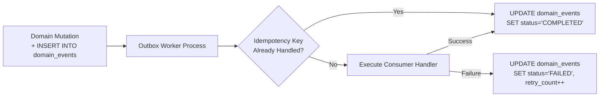
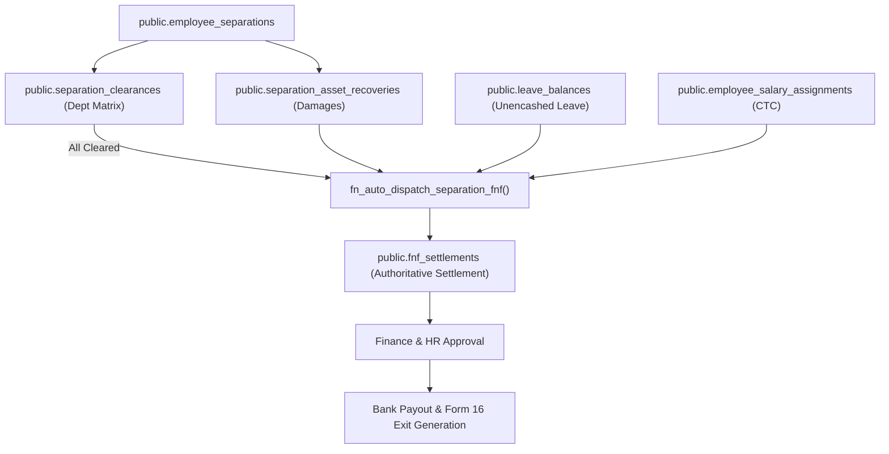

# JOY PeopleHR — Master Technical Blueprint & Architecture Specification
**Version:** 3.1-CANONICAL  
**Status:** Authoritative Engineering Standard  
**Last Updated:** September 8, 2026  
**Canonical Database Target:** Supabase PostgreSQL `ysiajemrqakfngasehhi` (77 Deployed Entities)  
**Supported Clients:** React 19 Enterprise Web (`WorkforceOS`) + Flutter Mobile App

---

## 1. System Vision & The WorkforceOS Paradigm

JOY PeopleHR is not a disparate collection of HR modules. It is an event-driven **Workforce Operating System (WorkforceOS)** designed around high-throughput biometric attendance ingestion, server-authoritative statutory payroll, single-source employee lifecycles, and cryptographic financial immutability.

```mermaid
flowchart TD
    subgraph ControlPlane["1. CONTROL PLANE"]
        TenantProvisioning["Organization & Legal Entities"]
        SubscriptionPlans["Subscription Plans & Entitlements"]
        GovernanceAudit["Global Security Audit & Compliance"]
    end

    subgraph IdentityLayer["2. IDENTITY & ACCESS (RBAC)"]
        GoTrue["Supabase GoTrue JWT Auth"]
        UserProfiles["user_profiles (1:1 with Auth)"]
        RBAC["Roles & Permissions Matrix (Tenant Scoped)"]
    end

    subgraph CoreWorkforce["3. CORE WORKFORCE & ASSETS"]
        EmployeeMaster["public.employees (Master Truth)"]
        StatutoryProfiles["Statutory PII (PAN, Aadhaar, PF, ESIC)"]
        HardwareAssets["Hardware & Asset Custody"]
    end

    subgraph RealTimePipes["4. TIME, ATTENDANCE & SHIFTS"]
        BiometricAgents["Biometric Device Ingestion"]
        Punches["public.attendance_punches (Raw Ingestion)"]
        AttendanceEngine["Server Punch Aggregation Engine"]
        DailyAttendance["public.attendance_daily (Server Calculated)"]
    end

    subgraph LeaveWorkflow["5. LEAVE & APPROVALS"]
        LeaveLedger["public.leave_ledger (Double-Entry Ledger)"]
        ApprovalEngine["Unified Multi-Tier Approval Engine"]
    end

    subgraph FinancialEngine["6. STATUTORY PAYROLL & FnF ENGINE"]
        SalaryStructures["Salary Structures & CTC Assignments"]
        PayrollRun["public.payroll_runs (Batch Calculations)"]
        PayrollLock["Financial Immutability Trigger Guard"]
        DigitalPayslips["public.payslips (Immutable Published)"]
        FnFSettlement["public.fnf_settlements (Exit Settlements)"]
    end

    ControlPlane --> IdentityLayer
    IdentityLayer --> CoreWorkforce
    CoreWorkforce --> RealTimePipes
    RealTimePipes --> LeaveWorkflow
    RealTimePipes --> FinancialEngine
    LeaveWorkflow --> FinancialEngine
```



---

## 2. Section 2A — Schema Reality Classification

To eliminate discrepancies between documentation and physical reality, every entity across all 22 modules is strictly categorized:

| Classification | Meaning | Total Entities |
|---|---|---|
| **`DEPLOYED`** | Verified present in live Supabase PostgreSQL schema cache | **77** |
| **`REFERENCED`** | Used in client repositories; verified and mapped to live DB | **77** |
| **`PLANNED`** | Required by target architecture enhancements in upcoming gates | **3** (`payroll_input_snapshots`, `platform_features`, `plan_features`) |
| **`DEPRECATED`** | Superseded by Greenfield canonical migrations | **0** |

### Live Table Manifest (77 Authoritative Entities)
1. `public.organizations` — Root multi-tenant organization container
2. `public.platform_plans` — SaaS plan definitions (Starter, Pro, Enterprise)
3. `public.saas_subscriptions` — Tenant active subscription & seat quota
4. `public.background_jobs` — Asynchronous job processing queue
5. `public.companies` — Legal corporate entities
6. `public.branches` — Operating company branches
7. `public.work_locations` — Physical locations with geofence radiuses
8. `public.departments` — Department structural hierarchy
9. `public.designations` — Role titles and band levels
10. `public.user_profiles` — Authenticated user accounts linked to `auth.users`
11. `public.roles` — Security role definitions
12. `public.permissions` — Fine-grained operational permissions
13. `public.role_permissions` — Role-to-permission mapping
14. `public.user_roles` — User-to-role assignment
15. `public.employees` — **Sole canonical employee master**
16. `public.employee_bank_details` — Bank accounts for salary disbursement
17. `public.employee_emergency_contacts` — Emergency next-of-kin contacts
18. `public.employee_family_details` — Family members and dependents
19. `public.employee_statutory_details` — PAN, Aadhaar, UAN, PF, ESIC
20. `public.employee_onboarding` — Pre-joining and document checklist tracker
21. `public.employee_lifecycle_events` — Career progression audit log
22. `public.employee_separations` — Resignations, terminations & notices
23. `public.separation_clearances` — Multi-department exit matrix (Migration 102)
24. `public.separation_asset_recoveries` — Asset recovery and damage deductions (Migration 102)
25. `public.shifts` — Shift policy and working hour definitions
26. `public.shift_assignments` — Employee-to-shift roster schedules
27. `public.attendance_punches` — Raw timestamped biometric/mobile punches
28. `public.attendance_daily` — Server-computed daily attendance records
29. `public.leave_types` — Leave policies and accrual rules
30. `public.leave_balances` — Yearly leave balance snapshots
31. `public.leave_requests` — Leave applications and manager decisions
32. `public.leave_ledger` — Immutable double-entry leave transaction ledger
33. `public.holiday_calendars` — Location-specific holiday calendar associations
34. `public.holidays` — Mandatory and optional public holidays
35. `public.approval_workflows` — Multi-tier approval routing rules
36. `public.approval_instances` — Live approval request instances
37. `public.approval_actions` — Step-by-step approval decisions
38. `public.salary_structures` — Master salary compensation templates
39. `public.salary_components` — Earnings, deductions, and statutory heads
40. `public.salary_structure_components` — Formulas binding components to structures
41. `public.employee_salary_assignments` — Active CTC and salary binding per employee
42. `public.payroll_runs` — Authoritative monthly batch payroll runs
43. `public.payroll_periods` — Backward-compatibility view mapping to `payroll_runs`
44. `public.payroll_run_history` — Immutable state transition audit log (Migration 101)
45. `public.payroll_line_items` — Immutable point-in-time calculation lines per employee
46. `public.payslips` — Published employee payslips
47. `public.fnf_settlements` — Full & Final exit settlements (Migration 102)
48. `public.domain_events` — Persistent transactional outbox domain events
49. `public.vendors` — Manpower vendor and staffing agency partners
50. `public.vendor_contracts` — Statement of work and master service agreements
51. `public.vendor_employees` — Deployed external contractor profiles
52. `public.vendor_invoices` — Monthly vendor timesheet billings
53. `public.vendor_compliance_documents` — Labor law and statutory proofs
54. `public.performance_cycles` — Quarterly and annual appraisal periods
55. `public.performance_reviews` — Self, peer, and manager evaluations
56. `public.goals` — OKR and objective tracking
57. `public.kpis` — Quantitative metric targets
58. `public.lms_courses` — Training and compliance course catalog
59. `public.lms_modules` — Learning lessons and assessment modules
60. `public.lms_enrollments` — Employee course progress and test scores
61. `public.lms_certifications` — Earned digital certificates
62. `public.documents` — Corporate document repository
63. `public.employee_documents` — Employee identity and credential files
64. `public.document_categories` — Document classification tags
65. `public.document_requirements` — Mandatory compliance document checklists
66. `public.employee_requests` — Internal service desk and HR queries
67. `public.asset_categories` — Hardware classification types
68. `public.assets` — Physical hardware inventory
69. `public.asset_assignments` — Asset custody tracking
70. `public.job_openings` — Talent acquisition requisitions
71. `public.candidates` — Applicant tracking pipeline
72. `public.interviews` — Candidate evaluation schedules
73. `public.notifications` — System and push notification queue
74. `public.notification_preferences` — User communication settings
75. `public.webhook_endpoints` — Third-party outbound webhooks
76. `public.audit_logs` — Immutable compliance security audit trail
77. `public.invoices` — SaaS platform customer billing invoices

---

## 3. Persistent Event Architecture & Contract Registry

Cross-module asynchronous side effects are decoupled via `public.domain_events` using the **Transactional Outbox Pattern** with mandatory **Idempotency Keys**.

### 3.1 Event Naming Convention
Global standard: `<domain>.<aggregate>.<past_tense_action>`

| Canonical Event Name | Emitting Module | Target Subsystem | Idempotency Key Format |
|---|---|---|---|
| `employee.employee.created` | People Core | Onboarding, Assets, IT | `emp-created-{orgId}-{empId}` |
| `employee.employee.exited` | Offboarding | Auth, IT, Payroll FnF | `emp-exited-{orgId}-{empId}` |
| `attendance.punch.recorded` | Biometric Engine | Attendance Processor | `att-punch-{orgId}-{empId}-{timestamp}` |
| `attendance.day.calculated` | Attendance Engine | Dashboard, Payroll | `att-day-{orgId}-{empId}-{date}` |
| `leave.request.approved` | Leave Engine | Shift Roster, Payroll LOP | `leave-appr-{orgId}-{requestId}` |
| `separation.clearance.completed` | Offboarding | Payroll FnF Engine | `sep-clear-{orgId}-{sepId}` |
| `payroll.run.calculated` | Payroll Engine | Reviewers, Audit | `pay-calc-{orgId}-{runId}` |
| `payroll.run.locked` | Payroll Engine | Payslip Generator, Banks | `pay-lock-{orgId}-{runId}` |
| `fnf.settlement.generated` | Offboarding / FnF | Finance, Approval | `fnf-gen-{orgId}-{sepId}` |
| `fnf.settlement.disbursed` | Payroll / FnF | Bank Outbox, Employee | `fnf-disb-{orgId}-{fnfId}` |

### 3.2 Outbox Processing Lifecycle


---

## 4. Attendance State Model & Time Anomaly Separation

To prevent corrupting downstream payroll calculations, attendance status must never be conflated with temporal anomalies.

### 4.1 Attendance Status (`public.attendance_daily.status`)
- `PRESENT` — Fulfilled daily threshold ($1.00$ payable day).
- `HALF_DAY` — Worked between half-day and full-day threshold ($0.50$ payable day).
- `ABSENT` — Unexcused absence ($0.00$ payable day, triggers LOP).
- `ON_LEAVE` — Approved leave ($1.00$ paid leave or $0.00$ unpaid leave).
- `WEEKLY_OFF` — Scheduled rest day ($1.00$ payable day).
- `HOLIDAY` — Public/mandatory holiday ($1.00$ payable day).
- `OD` — Official Duty / Field assignment ($1.00$ payable day).
- `WFH` — Remote work approved ($1.00$ payable day).
- `REGULARIZATION_PENDING` — Punch dispute awaiting manager signoff.

### 4.2 Time Anomalies (`public.attendance_daily.anomalies JSONB`)
Recorded independently from status:
```json
{
  "anomalies": [
    { "type": "LATE_IN", "minutes": 24, "grace_exceeded": true },
    { "type": "EARLY_OUT", "minutes": 15 },
    { "type": "OUT_OF_GEOFENCE", "distance_meters": 340 }
  ]
}
```

---

## 5. Payroll Immutability & Input Snapshotting

### 5.1 The Immutability Guarantee
Once a payroll batch enters `LOCKED` or `DISBURSED`, database trigger `trg_prevent_locked_payroll_mutation` enforces:
1. Zero modifications to `total_gross_pay`, `total_deductions`, or `total_net_pay`.
2. Zero alterations or deletions on `public.payroll_line_items` and generated `public.payslips`.
3. Direct reopening is prohibited. Retroactive adjustments must be queued into the subsequent cycle as an adjustment item.

### 5.2 Input Snapshot Architecture (`public.payroll_input_snapshots`)
To prevent historical payroll calculations from changing if an employee's profile, salary structure, or historical attendance is modified later, every payroll run snapshots its inputs:
```text
PAYROLL RUN
    │
    ├── Employee Salary Structure Snapshot (Basic, HRA, Allowances, CTC)
    ├── Attendance Days Snapshot (Present, Half-Day, LOP, OT Hours)
    ├── Approved Leave Snapshot (Paid, Unpaid, Encashments)
    └── Statutory Tax Table Snapshot (EPF Ceiling, ESIC Slab, PT Bracket)
```

---

## 6. Dedicated Full & Final (FnF) Settlement Architecture

Exit settlements represent a distinct financial workflow with unique statutory obligations (Payment of Gratuity Act 1972, notice period buyouts, hardware damage assessments).



---

## 7. Unified Approval Engine with Domain Adapters

To prevent the approval engine from becoming a fragile monolith, approval instances orchestrate decisions while domain tables retain authoritative business records:

```text
DOMAIN RECORD (e.g. leave_requests, expense_claims, overtime_requests)
      │
      ▼ (Creates instance)
approval_instances
      │
      ▼ (Multi-tier decision)
approval_actions (Manager -> HR -> Finance)
      │
      ▼ (Decision Event)
DOMAIN ADAPTER
      │
      ▼ (Mutates domain truth)
leave_requests.status = 'APPROVED'
```

---

## 8. Multi-Tier Feature Entitlement Catalog

Feature visibility is governed across three tiers:
1. **Catalog Layer:** `public.platform_features` (Feature keys & descriptions)
2. **Package Layer:** `public.plan_features` (Binding features to Starter, Pro, Enterprise)
3. **Tenant Layer:** `public.saas_subscriptions` + `organizations.feature_overrides`

Protected across UI (`Sidebar.tsx`), routing (`RouteGuard.tsx`), and data API (`canUseFeature()` + RLS).

---

## 9. Canonical Service Architecture (Section 15)

Every client interaction must follow a strict 5-layer separation:

```text
React Component / View
         │
         ▼
Custom Feature Hook (e.g., useAttendance, usePayroll)
         │
         ▼
Domain Service API (e.g., attendanceApi, payrollApi, offboardingService)
         │
         ▼
Authoritative RPC / Repository (e.g., fn_recalculate_daily_attendance)
         │
         ▼
Supabase PostgreSQL Data Platform (with RLS)
```
**Rule:** React components must never contain business calculation formulas.

---

## 10. API / RPC Contract Registry (Section 16)

| Operation | Function Signature | Input Schema | Output Schema |
|---|---|---|---|
| Recalculate Day Attendance | `fn_recalculate_daily_attendance` | `p_employee_id UUID, p_date DATE` | `{ success: bool, status: text, work_minutes: int }` |
| Transition Payroll Status | `fn_transition_payroll_status` | `p_run_id UUID, p_to_status text, p_actor_id UUID` | `{ success: bool, from_status: text, to_status: text }` |
| Dispatch Separation FnF | `fn_auto_dispatch_separation_fnf` | `p_separation_id UUID, p_actor_id UUID` | `{ success: bool, settlement_id: UUID, net_payable: num }` |
| Check Feature Entitlement | `canUseFeature` | `featureKey: string, tenantId: string` | `boolean` |

---

## 11. Data Ownership Registry (Section 17)

To eliminate race conditions and contradictory states, every table has **exactly one primary domain owner**:

| Domain Master Table | Primary Domain Owner | Secondary Modules (Read Only) |
|---|---|---|
| `public.employees` | People Core | All Modules |
| `public.attendance_punches` | Attendance Core | None |
| `public.attendance_daily` | Attendance Engine | Payroll, Leaves, Reports |
| `public.leave_balances` | Leave Engine | Payroll (LOP / Encashment) |
| `public.payroll_runs` | Payroll Engine | Reports, General Ledger |
| `public.fnf_settlements` | Payroll / FnF Engine | Offboarding, Finance |
| `public.assets` | Asset Management | Offboarding (Recovery) |
| `public.approval_instances` | Workflow Engine | Originating Modules |

---

## 12. Migration & Rollback Policy (Section 18)

Every schema enhancement must supply:
1. **Forward SQL (`.sql`):** Idempotent DDL with `IF NOT EXISTS` and RLS policies.
2. **Backward Compatibility Layer:** Views or column fallbacks protecting legacy consumers.
3. **Data Backfill Procedure:** Safe migration of legacy or client-cached records.
4. **Verification Script (`.mjs`):** Script validating table presence and foreign key integrity.
5. **Rollback Strategy:** Clean reverse DDL restoring previous state without data loss.

---

## 13. Cross-Platform Contract: Web & Flutter Parity (Section 19)

JOY PeopleHR serves both React Web and Flutter Mobile. Business calculations must **never diverge**:
- Mobile and Web invoke the **exact same database stored procedures** (`fn_recalculate_daily_attendance`, `fn_transition_payroll_status`).
- Mobile biometric check-ins insert into `public.attendance_punches`; server triggers compute the daily record.
- Neither Web nor Mobile shall implement isolated client-side salary or tax calculation engines.

---

## 14. Exit-Criteria-Driven Engineering Roadmap

Instead of arbitrary calendar deadlines, engineering progress is governed strictly by verifiable exit criteria:

```text
Gate 0: Reality Audit
  [x] Live Supabase schema audited (77 entities verified deployed)
  [x] Zero compile errors on tsc --noEmit
  [x] 100% security & reality gates passed

Gate 1: Attendance Stabilization
  [x] Punch arrival triggers automatic recalculation without user login
  [x] Idempotent punches generate deterministic daily records
  [ ] Time anomaly JSON separation in attendance_daily

Gate 2: Payroll Immutability
  [x] Lock triggers block modification of finalized runs
  [x] Client services use RFC4122 v4 UUIDs and query payroll_runs
  [ ] Deploy payroll_input_snapshots table

Gate 3: Offboarding to FnF Integration
  [x] Multi-department clearance matrix deployed
  [x] Atomic fn_auto_dispatch_separation_fnf RPC calculates unencashed leave, notice & assets
  [x] Reactive UI queue in Payroll FnF module

Gate 4: Unified Approvals & Outbox Event Mesh
  [ ] Domain adapters routing leave, overtime, and travel approvals
  [ ] Outbox worker consuming domain_events with idempotency_key
```
