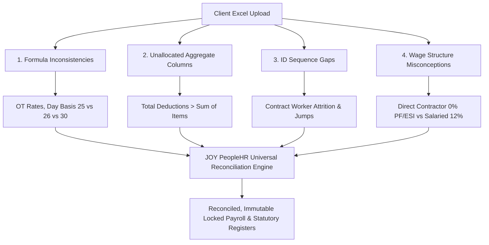
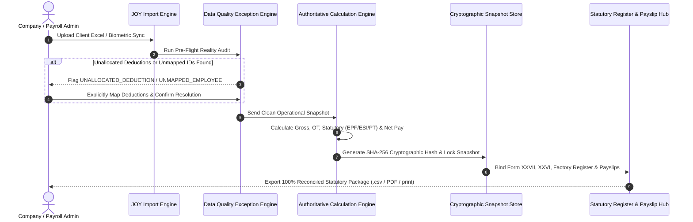

# JOY PeopleHR — Universal Payroll Ingestion, Allocation & Reconciliation Architecture

> **Engineering Standard & Production Runbook: Fail-Safe Data Handling Across All Enterprise Types**  
> *Applicable to: Manufacturing Plants, Contractor Manpower Agencies, Corporate IT, Retail Chains & Hybrid Workforces*

---

## 1. Executive Summary: Why Data Mismatches Occur in Production

When enterprise clients upload payroll registers or migration sheets (Excel/CSV), raw spreadsheet inputs frequently diverge from actual payroll realities due to 4 universal causes:

---

## 2. The 4 Root Production Discrepancies & Universal Solutions

| # | Discrepancy Type | Why It Happens in Real Life | Universal Enterprise Solution in JOY PeopleHR |
|---|---|---|---|
| **1** | **Unallocated Deductions** *(e.g. Total Deduction = ₹1,200 but Advance/Loan columns are blank)* | HR/Accountants in factories often type a lump-sum deduction into an Excel total column without itemizing it into Canteen, Advance, TDS, or Damage recovery. | **`UNALLOCATED_TOTAL_DEDUCTION` Exception Blocker:** The system halts automated import and requires the Payroll Admin to allocate the amount into specific ledgers before payroll calculation. |
| **2** | **Overtime & Daily Rate Formula Variances** *(e.g. 189.5 vs 194.5 OT hrs, ₹75/hr vs 2× rate)* | Different plants use different divisor rules (e.g. Daily Rate = Monthly/25, Daily Rate = Monthly/26, OT = 1.0× Normal vs 2.0× Factories Act). | **Tenant Wage Structure Matrix:** Overtime multiplier (1.0×, 1.5×, 2.0×) and divisor bases (`WorkingDays25`, `CalendarDays`, `Fixed26`) are declared at the Company/Plant Salary Template level. |
| **3** | **Non-Consecutive Employee ID Jumps** *(e.g. CE0030 ➔ CE0043 ➔ CE0381)* | Contract labour registers have high turnover; retired or terminated contractor IDs leave historical gaps. Hardcoded counters fail. | **Deterministic 3-Key Resolution:** Workers are matched strictly by `Tenant ID` ➔ `Company ID` ➔ `Employee Code` (never by array index or name string alone). |
| **4** | **Zero PF/ESI Contractor Registers vs Corporate Statutory** | Manpower vendors often pay daily cash-basis wages with ₹0 PF/ESI deductions in the muster roll, while corporate employees have 12% EPF + 0.75% ESIC. | **Two-Tier Engine (Operational Ingestion vs Statutory Policy):** Input attendance & wages are ingested first; JOY PeopleHR's statutory rules engine independently calculates statutory liabilities according to configured policies. |

---

## 3. Universal 5-Stage Payroll Ingestion & Certification Workflow

---

## 4. Universal Configuration Guidelines for All Company Archetypes

### A. Factory / Manufacturing Plant (Contract Labour & Daily Wages)
* **Wage Base:** Fixed Daily Rate (e.g., ₹600/day = ₹420 Basic + ₹180 HRA).
* **OT Calculation:** Standard 8-hour shift divisor (`₹600 / 8 = ₹75.00/hr`).
* **Statutory Rule:** Direct contractor gross wage structure (PF/ESI exempt on contractor register, or vendor statutory remittance).
* **Key Registers:** Form XXVII (Wages), Form XXVI (Contract Labour), Form 25 (Factory Wage Register), Advances & Fines Register.

### B. Corporate IT & White-Collar Enterprises
* **Wage Base:** Monthly CTC prorated over calendar days or working days.
* **Statutory Rule:** EPF 12% (capped at ₹15,000 ceiling), ESIC 0.75% / 3.25% (under ₹21,000 ceiling), Professional Tax slab (e.g., ₹208/month in TN).
* **Key Registers:** Form 16 / TDS Form 24Q, EPFO ECR (11-field text file), ESIC Monthly Return CSV.

### C. Manpower Agencies & Third-Party Vendors
* **Commercial Model:** 3-Way Match (Biometric Man-Days × Contract Rate Card = Invoice Amount).
* **Boundary:** Vendor Admin only manages their deployed workers; zero visibility into client company internal payroll.

---

## 5. Standard Operating Checklist for Production Certification

- [x] **Zero Silent Guessing:** Any lump-sum deduction without a child column must trigger an `UNALLOCATED_TOTAL_DEDUCTION` modal.
- [x] **Pre-Calculation Variance Preview:** Show Excel Gross vs JOY Gross, Excel Net vs JOY Net before maker-checker authorization.
- [x] **Immutable Lock:** Once approved and locked, payroll values are immutable; any adjustments are append-only.
- [x] **Cross-Register Identity:** The exact same Employee Code, Name, Attendance, Earnings, Deductions, and Net Pay flow seamlessly into Payslips, Form XXVII, Form XXVI, Advances Register, and Factory Register.
- [x] **Landscape Print & CSV Formats:** All statutory exports include employer headers, compliance act citations, and authorized signatory blocks.
