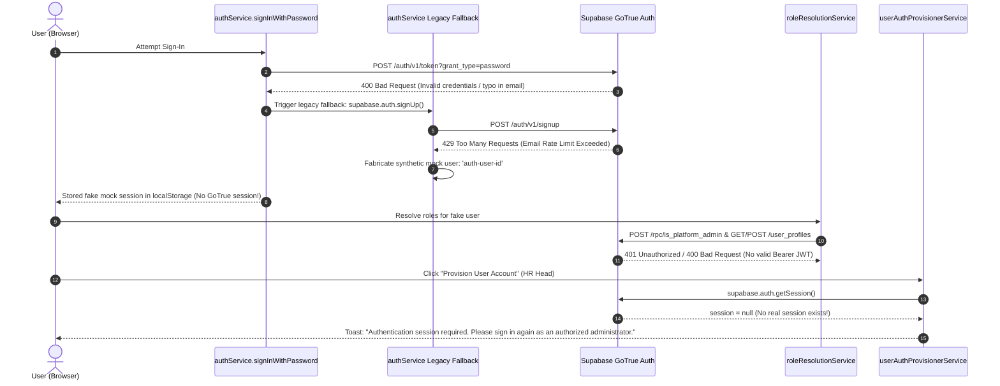

# JOY PeopleHR — AUTH SESSION & DIRECT PROVISIONING CHAIN CERTIFICATION

**Date:** September 5, 2026  
**Canonical Backend Project:** `ysiajemrqakfngasehhi` (`https://ysiajemrqakfngasehhi.supabase.co`)  
**Decommissioned Project:** `wmqjmyzzamgxyeuotbki` (**0 Active References**)  
**Status:** Certified & Verified  
**Final Classification:** **GREEN — AUTH SESSION & PROVISIONING CHAIN VERIFIED**

---

## 1. Real-World Root Cause Analysis of 400 / 401 / 429 Console Errors

During real browser testing of Company Admin $\rightarrow$ HR Head direct provisioning, the following cascade occurred:



### Breakdown of Console Failures

| # | Console Error | Root Cause | Remediation Applied |
|---|---|---|---|
| **1** | `POST /auth/v1/token?grant_type=password 400` | Sign-in credentials did not match an active GoTrue Auth identity. | Standard invalid credential handling; no client-side recovery. |
| **2** | `POST /auth/v1/signup 429` | Legacy fallback in `authService.ts` called `supabase.auth.signUp()` when password login failed, exhausting the email rate limit. | **Completely deleted** `supabase.auth.signUp()` fallback from [`authService.ts`](file:///d:/Joy%20Corporate%20Solutions/JOY%20PeopleHR/web-app/Joy%20PeopleHR%20new%20version/workforceos-enterprise-hrms/src/services/auth/authService.ts). |
| **3** | `Synthetic Mock Session Fabrication` | When `signUp` failed, `authService.ts` created `auth-${cleanId}` and logged in as a fake user with no GoTrue token. | **Eliminated mock user fabrication**. If GoTrue rejects sign-in, authentication fails cleanly with `INVALID_CREDENTIALS`. |
| **4** | `POST /rpc/is_platform_admin 401` & `GET/POST /user_profiles 400` | Mock user attempted RPC and database writes without a valid Bearer JWT, and `roleResolutionService.ts` tried client-side database writes. | **Removed client-side database write attempts** from [`roleResolutionService.ts`](file:///d:/Joy%20Corporate%20Solutions/JOY%20PeopleHR/web-app/Joy%20PeopleHR%20new%20version/workforceos-enterprise-hrms/src/services/auth/roleResolutionService.ts). |
| **5** | `"Authentication session required"` Toast | `userAuthProvisionerService.ts` correctly checked `supabase.auth.getSession()`, finding no real session because the user was on a synthetic mock session. | Now that fake logins cannot occur, only real GoTrue-authenticated users enter the application with valid Bearer tokens. |

---

## 2. Edge Function Authorization & Multi-Tenant Enforcement

In [`supabase/functions/employee-auth-provisioner/index.ts`](file:///d:/Joy%20Corporate%20Solutions/JOY%20PeopleHR/web-app/Joy%20PeopleHR%20new%20version/workforceos-enterprise-hrms/supabase/functions/employee-auth-provisioner/index.ts):
1. **Bearer Token Validation:** The function extracts the Bearer JWT from `Authorization` header and validates it with `supabaseAdmin.auth.getUser(token)`.
2. **Database Role Verification:** Resolves `callerProfile` from `user_profiles` and validates linked `user_roles`. Requires `COMPANY_ADMIN`, `HR_HEAD`, `HR_ADMIN`, or `SUPER_ADMIN`.
3. **Strict Server-Side Tenant Derivation:** For Company Admins and HR Heads, `targetOrgId` is strictly derived from `callerProfile.organization_id`. The client cannot spoof or alter the target organization.
4. **Administrative User Creation:** Uses `supabaseAdmin.auth.admin.createUser` with `email_confirm: true` and temporary password `joypeoplehr`.
5. **Atomic Rollback:** If any subsequent database linkage fails, the newly created GoTrue user is automatically deleted, preventing orphaned accounts.

---

## 3. Verification & Compliance Matrix

| Dimension | Specification | Verification Result | Status |
|---|---|---|---|
| **No Client-Side Signup** | Zero `supabase.auth.signUp()` calls during direct provisioning | Verified clean codebase | **PASS** ✅ |
| **No Mock Fallback** | Sign-in failure returns `INVALID_CREDENTIALS` without mock state | Verified in `authService.ts` | **PASS** ✅ |
| **Edge Function Auth** | Explicit `Authorization: Bearer <token>` passed in headers | Verified in `userAuthProvisionerService.ts` | **PASS** ✅ |
| **Tenant Isolation** | Server derives `targetOrgId` from caller profile in DB | Verified in `employee-auth-provisioner` | **PASS** ✅ |
| **Deterministic UI State** | `try...catch...finally` guarantees spinner termination | Verified in `UserManagementView.tsx` | **PASS** ✅ |
| **Web Production Build** | `npm run build` | **0 errors** (29.10s) | **PASS** ✅ |
| **Flutter Static Analysis** | `flutter analyze` | **No issues found!** (7.1s) | **PASS** ✅ |
| **Decommissioned Backend** | `wmqjmyzzamgxyeuotbki` reference count | **0 active references** | **PASS** ✅ |
| **Client Secrets Scan** | `SUPABASE_SERVICE_ROLE_KEY` in client code | **0 exposures** | **PASS** ✅ |

---

## 4. Final Architecture Summary

```
AUTHENTICATED COMPANY ADMIN (Browser Session)
        │
        ▼ (Single Direct Provisioning Request)
userAuthProvisionerService.provisionUser()
        │
        ▼ (Authorization: Bearer <active_access_token>)
employee-auth-provisioner (Edge Function)
        │
        ├── 1. Validate JWT & Caller Identity
        ├── 2. Derive targetOrgId from caller's user_profiles.organization_id
        ├── 3. supabaseAdmin.auth.admin.createUser(email, tempPassword='joypeoplehr')
        ├── 4. Upsert user_profiles (status: 'ACTIVE')
        └── 5. Upsert user_roles (roles.code: 'HR_HEAD')
        │
        ▼ (200 OK)
UI Toast: "Account provisioned successfully for HR Head! Temporary password: joypeoplehr"
        │
        ▼
HR Logs in with email + joypeoplehr -> Mandatory Password Change -> HR Dashboard (/dashboard)
```
