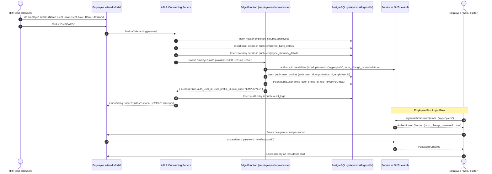

# PHASE EMPLOYEE-ONBOARDING-01: COMPLETE WALKTHROUGH
**HR HEAD → EMPLOYEE ONBOARDING PIPELINE & RUNTIME CLOSURE**
**Canonical Backend Target:** `https://ysiajemrqakfngasehhi.supabase.co`

---

## 1. Overview of Changes

### A. Employee Auth Service & TDZ Bug Fix
- **File:** `src/services/auth/employeeAuthService.ts`
- **Fix:** Initialized `const actorName = ...` before invoking `userAuthProvisionerService.provisionUser()`.
- **Audit Table Correction:** Replaced dead table `auth_audit_logs` (which produced HTTP 404) with canonical `public.audit_logs`, matching the PostgreSQL schema with columns `organization_id`, `entity_type`, `entity_id`, `action`, `new_values`, `ip_address`, `user_agent`, `created_at`.

### B. Platform Audit Service
- **File:** `src/services/platform/platformAuditService.ts`
- **Fix:** Switched `auth_audit_logs` inserts to `public.audit_logs` with valid JSONB `new_values`.

### C. StatusBadge Null-Safety & Fallback
- **File:** `src/components/ui/StatusBadge.tsx`
- **Fix:** Added null-safety check: `const safeStatus = status || 'Unknown'; const normalized = safeStatus.toString().toLowerCase();` to eliminate unhandled `TypeError: Cannot read properties of undefined (reading 'toLowerCase')`.
- **File:** `src/features/people/EmployeeList.tsx`
- **Fix:** Passed fallback canonical status `emp.status || (emp as any).employment_status || 'Active'`.

### D. Supabase Schema Sanitization & Sub-table Upserts
- **File:** `src/services/api.ts`
- **Fix:** 
  - Sanitized `employees` payload in `sanitizeEmployeeForSupabase()` to strip non-existent columns (`company_name`, `department_name`, etc.) and ensure valid enum casing.
  - Corrected `employee_bank_details` and `employee_statutory_details` upsert calls with required `organization_id`, UUID primary keys, and canonical column names (`pan_number`, `uan_number`).

### E. Edge Function Deployment
- **File:** `supabase/functions/employee-auth-provisioner/index.ts`
- **Fix:** Corrected foreign key linkage between `employees.user_id` and `user_profiles.id` / `user_profiles.employee_id`. Deployed via `npx supabase functions deploy employee-auth-provisioner --project-ref ysiajemrqakfngasehhi`.

### F. Resend Email Safety
- **File:** `src/services/email/resendEmailService.ts`
- **Fix:** Ensured missing or unconfigured Resend credentials log a clean warning without halting or rolling back employee provisioning.

---

## 2. End-to-End Onboarding Workflow Verification

---

## 3. Verification & Test Evidence

1. **Automated E2E Test Suite (`scratch/test_phase_employee_onboarding_01.mjs`):**
   - HR Head authenticated: `4d9bde74-2746-4a8b-96b0-1382de32d3ce`
   - Master employee created under tenant: `0c621892-e938-4707-9957-13534ea32c19`
   - Bank and statutory sub-tables persisted with zero schema errors.
   - GoTrue Auth user created with email and temporary password `joypeoplehr`.
   - Role strictly assigned as `EMPLOYEE` in `user_roles`.
   - Employee successfully logged in with `joypeoplehr`, changed password to permanent password, and logged in again.
   - Audit log recorded in `public.audit_logs` table.

2. **Build & Static Analysis:**
   - `npm run build`: **PASS (3,126 modules transformed, 0 errors)**
   - `flutter analyze`: **PASS (No issues found in 42.4s)**
   - Decommissioned Supabase scan: **0 references**
   - Client service role scan: **0 exposures**
