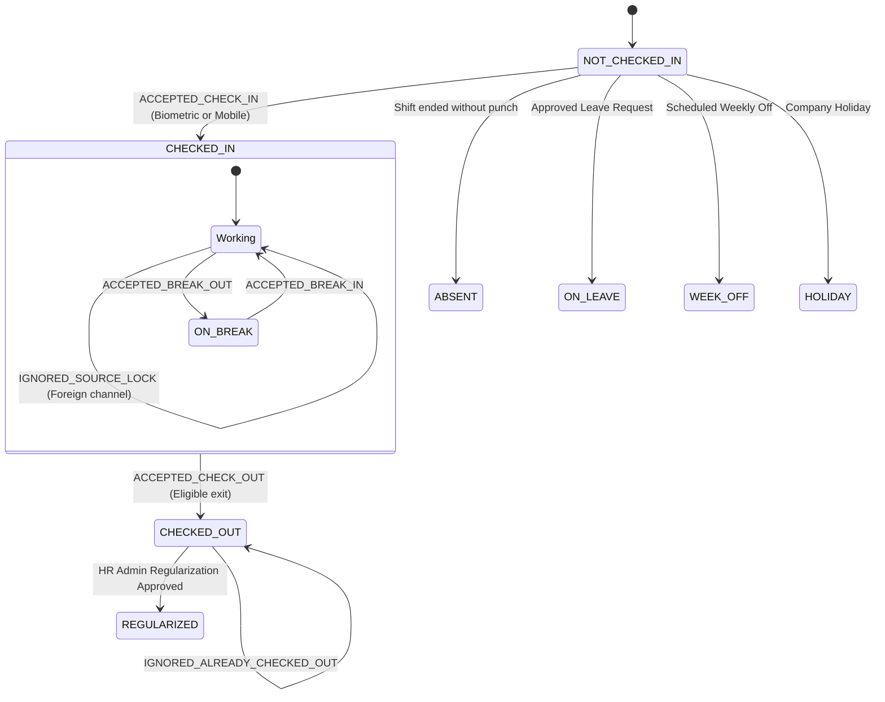

# JOY PeopleHR — Attendance Session State Machine
**Formal Lifecycle Transitions for Authoritative Workday Sessions**

---

## 1. Attendance Session States

---

## 2. State Transition Matrix

| Current State | Trigger Event | Guard Condition | Next State | Action / Side Effect |
| :--- | :--- | :--- | :--- | :--- |
| `NOT_CHECKED_IN` | Ingest punch | First valid accepted punch | `CHECKED_IN` | Lock source, record `first_in_at`, start mobile timer |
| `CHECKED_IN` | Subsequent punch | Same source, `< 240m` & not OUT | `CHECKED_IN` | Record raw event, keep session active, timer continues |
| `CHECKED_IN` | Foreign punch | Channel != locked source | `CHECKED_IN` | Flag `IGNORED_SOURCE_LOCK`, save in raw audit, 0 UI changes |
| `CHECKED_IN` | Repeat punch | Same timestamp/key `< 3s` | `CHECKED_IN` | Flag `DUPLICATE`, ignore in ledger |
| `CHECKED_IN` | Checkout punch | Explicit OUT or in checkout window | `CHECKED_OUT` | Set `last_out_at`, stop mobile timer, compute net hours & OT |
| `CHECKED_OUT` | Later exit punch | Later timestamp on same day | `CHECKED_OUT` | Update `last_out_at` (Last-Out Rule), recalculate OT |
| `CHECKED_OUT` | Repeat checkout | Explicit check-out intent | `CHECKED_OUT` | Return `IGNORED_ALREADY_CHECKED_OUT`, session untouched |
| `CHECKED_OUT` | HR Correction | Admin regularization | `REGULARIZED` | Immutable audit log, append-only ledger entry |

---

## 3. Mobile Live Timer Reactivity

The mobile working timer is a pure client presentation projection derived from the authoritative backend session:

$$\text{Live Working Seconds} = \max\left(0, \left\lfloor \frac{T_{\text{now}} - T_{\text{first\_in\_at}}}{1000} \right\rfloor\right)$$

- When in state `NOT_CHECKED_IN`: Timer is idle (00:00:00).
- When in state `CHECKED_IN`: Timer ticks second-by-second using server-authoritative `first_in_at`.
- When in state `CHECKED_OUT`: Timer freezes at exact net worked hours.
- When `IGNORED_SOURCE_LOCK` event arrives: Timer ignores it and continues uninterrupted.
