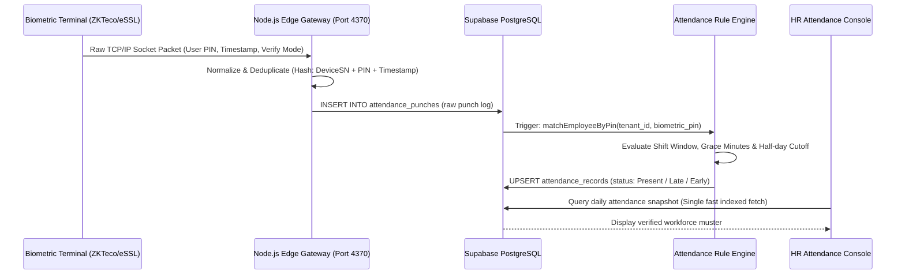

# Joy PeopleHR — Complete Technical Architecture Dossier

**Authoritative Engineering Blueprint & Architecture Review**  
**Database Reference:** Canonical Supabase PostgreSQL (`ysiajemrqakfngasehhi`)  
**Core Technologies:** React 19 • TypeScript 5.8 • Vite 6 • TailwindCSS v4 • Flutter 3.x • Node.js IoT Connector • Supabase Auth & RLS

---

## 1. Complete Technical Stack Inventory

| Tier | Component | Technology & Verified Packages |
| :--- | :--- | :--- |
| **Web Frontend** | Core Framework | React 19.0.1, TypeScript 5.8.2, Vite 6.2.3, ES Modules |
| **Web Styling** | Design System | TailwindCSS 4.1.14 (via `@tailwindcss/vite`), Radix UI Primitives, Lucide Icons 0.546 |
| **State & Data** | Server State & Cache | `@tanstack/react-query` 5.101.4, React Hook Form 7.85 with Zod 4.4 validation |
| **Visualization** | Charts & Analytics | Recharts 3.10.1, Motion 12.23 (Framer Motion engine) |
| **Document Export**| PDF & Excel Generation | `jspdf` 4.2.1, `html2canvas` 1.4.1, `xlsx` 0.18.5, `pdfjs-dist` 6.2.108 |
| **Backend & DB** | Database & BaaS | PostgreSQL 15+ hosted on Supabase Enterprise, `@supabase/supabase-js` 2.112.3 |
| **Cache & Limits** | Edge Throttling | Upstash Redis (`@upstash/redis` 1.38.4) & Upstash Ratelimit (`@upstash/ratelimit` 2.0.8) |
| **Mobile Client** | Native Framework | Flutter 3.x (Dart >= 3.0.0 < 4.0.0), `supabase_flutter` 2.8.0, `shadcn_flutter` 0.0.43 |
| **Mobile Hardware**| Sensors & Services | `geolocator` 13.0.2 (GPS geofencing), `firebase_messaging` 15.1.3 (Push), `pdfx` 2.6 (PDFs) |
| **Biometric IoT** | Hardware Adapters | `node-zklib` 1.3.0 (ZKTeco/eSSL standalone TCP socket driver), Mantra USB Bio API |
| **Testing & CI** | Test Automation | Playwright 1.63 (Chromium E2E testing), Vitest 5.0 (Unit tests), TypeScript Strict (`tsc --noEmit`) |

---

## 2. High-Level System Architecture Diagram

```
                        ┌────────────────────────────────────────────────────────┐
                        │             JOY PEOPLEHR SYSTEM PLATFORM               │
                        └──────────────────────────┬─────────────────────────────┘
                                                   │
             ┌─────────────────────────────────────┼─────────────────────────────────────┐
             │                                     │                                     │
             ▼                                     ▼                                     ▼
   ┌───────────────────┐                 ┌───────────────────┐                 ┌───────────────────┐
   │  ENTERPRISE WEB   │                 │  FLUTTER MOBILE   │                 │   IOT HARDWARE    │
   │  React 19 / Vite  │                 │ iOS & Android APK │                 │  eSSL / ZKTeco    │
   │  - HR Management  │                 │ - Geofenced Punch │                 │  - TCP/IP Sockets │
   │  - Payroll Engine │                 │ - Leave & Balances│                 │  - Port 4370 Raw  │
   │  - Vendor Portal  │                 │ - Payslip Viewer  │                 │  - Edge Agent     │
   └─────────┬─────────┘                 └─────────┬─────────┘                 └─────────┬─────────┘
             │                                     │                                     │
             │ HTTPS / REST / WebSockets           │ HTTPS / REST                        │ TCP/IP Outbound / REST
             └─────────────────────────────────────┼─────────────────────────────────────┘
                                                   │
                                                   ▼
                        ┌────────────────────────────────────────────────────────┐
                        │                SUPABASE AUTHENTICATION                 │
                        │   - JWT Claims Injection (tenant_id, company_id, role)  │
                        │   - Strict Role-Based Portal Isolation (Vendor vs HR)   │
                        └──────────────────────────┬─────────────────────────────┘
                                                   │
                                                   ▼
                        ┌────────────────────────────────────────────────────────┐
                        │              POSTGRESQL DATABASE ENGINE                │
                        │   - 64 Greenfield Normalized Tables                    │
                        │   - Native Row-Level Security (RLS) on Every Table     │
                        │   - PostgreSQL Stored Functions & Triggers             │
                        └──────────┬───────────────────────────────┬─────────────┘
                                   │                               │
             ┌─────────────────────┴─────────────┐   ┌─────────────┴─────────────────────┐
             ▼                                   ▼   ▼                                   ▼
   ┌───────────────────┐               ┌───────────────────┐                   ┌───────────────────┐
   │ SECURE S3 STORAGE │               │  EVENT PIPELINE   │                   │  UPSTASH SERVICE  │
   │ - employee-docs   │               │ - pg_cron Jobs    │                   │ - Edge Rate Limit │
   │ - workforce-docs  │               │ - Webhook Emitter │                   │ - Ephemeral Cache │
   │ - payslips (PDFs) │               │ - Immutable Audit │                   │ - Session Buffer  │
   └───────────────────┘               └───────────────────┘                   └───────────────────┘
```

---

## 3. Database Multi-Tenancy & Security Isolation

### Row-Level Security (RLS) Architecture
Every single table in Joy PeopleHR has Row-Level Security enforced at the PostgreSQL kernel level:
1. **Tenant Isolation (`organization_id`)**:
   - Every table contains `organization_id UUID NOT NULL REFERENCES public.organizations(id)`.
   - The user's authenticated JWT carries their authorized `organization_id` via custom claims or lookup in `public.user_profiles`.
   - Base RLS Policy Pattern:
     ```sql
     CREATE POLICY "tenant_isolation_policy" ON public.employees
     FOR ALL TO authenticated
     USING (
       organization_id = (SELECT organization_id FROM public.user_profiles WHERE user_id = auth.uid())
     );
     ```
2. **Company Boundary (`company_id`)**:
   - Users belonging to a specific legal entity (e.g. `comp-001`) are constrained from querying or mutating records belonging to sibling companies in the same organization unless granted `ORGANIZATION_ADMIN` privileges.
3. **Vendor Sandbox Boundary (`vendor_id`)**:
   - Third-party manpower vendors authenticate via `PortalType.VENDOR`.
   - RLS strictly prohibits vendor accounts from querying the `employees`, `salary_structures`, or `payroll_runs` tables.
   - Vendors only have read/write access to `vendor_workers`, `vendor_deployments`, `vendor_invoices`, and `vendor_licenses` scoped exclusively to their own `vendor_id`.

---

## 4. Biometric Attendance Architecture

### Architectural Decision: Database-First Manual Synchronization vs WebSockets
> [!IMPORTANT]
> **Production Reality**: The system previously experimented with high-frequency Supabase Realtime WebSocket subscriptions on the biometric monitoring pages. Under real factory load (thousands of punches in minutes during shift change), direct WebSocket fan-out caused client-side DOM freezes and connection exhaustion.
> 
> **Current Authoritative Architecture**: Joy PeopleHR utilizes a **Database-First Manual Synchronization Architecture**:
> 1. Raw punches are ingested by the background Node.js gateway and written directly to `public.attendance_punches`.
> 2. An asynchronous SQL state machine (`20260908_100_server_attendance_processing_engine.sql`) validates, classifies, and inserts/updates `public.attendance_records`.
> 3. The web UI reads from database-indexed views and offers a fast, on-demand "Sync Live" button with debounced auto-polling, ensuring zero UI lag and 100% data integrity.

### Biometric Hardware Ingestion Flow


---

## 5. Authoritative Payroll Calculation Engine

The single mathematical source of truth for payroll is implemented in [`authoritativePayrollEngine.ts`](file:///d:/web-app%20(2)/Joy%20PeopleHR/src/services/payroll/authoritativePayrollEngine.ts), operating in exact compliance with Indian Labor Standards:

### Formula Hierarchy

#### 1. Earnings Breakdown
$$\text{Payable Days} = \text{Worked Days} + \text{Paid Leaves} + \text{Weekly Offs} - \text{LOP Days}$$
$$\text{Basic Earned} = \frac{\text{Monthly Basic Fixed}}{\text{Fixed Working Days}} \times \text{Payable Days}$$
$$\text{HRA Earned} = \frac{\text{Monthly HRA Fixed}}{\text{Fixed Working Days}} \times \text{Payable Days}$$
$$\text{Gross Earnings} = \text{Basic Earned} + \text{HRA Earned} + \text{Allowances} + \text{OT Wages}$$

#### 2. Overtime Engine (Code on Wages 2019 / Factories Act 1948)
$$\text{Hourly OT Rate} = \left( \frac{\text{Basic Earned} + \text{DA}}{\text{Fixed Working Days} \times 8\text{ hrs}} \right) \times 2.0$$
$$\text{OT Wages Earned} = \text{Approved OT Hours} \times \text{Hourly OT Rate}$$

#### 3. Statutory Deductions
- **Employee Provident Fund (EPF)**:
  $$\text{PF Wage Base} = \min(\text{Basic} + \text{DA}, ₹15,000) \quad (\text{or uncapped if opted})$$
  $$\text{Employee PF} = 12\% \times \text{PF Wage Base}$$
  $$\text{Employer PF} = 13\% \times \text{PF Wage Base} \quad (\text{EPS } 8.33\% + \text{EPF } 3.67\% + \text{Admin } 0.5\% + \text{EDLI } 0.5\%)$$
- **Employee State Insurance (ESIC)**:
  $$\text{Eligibility}: \text{Gross Earnings} \le ₹21,000/\text{month}$$
  $$\text{Employee ESI} = 0.75\% \times \text{Gross Earnings}$$
  $$\text{Employer ESI} = 3.25\% \times \text{Gross Earnings}$$
- **Professional Tax (PT)**: Computed dynamically based on state slab rules (e.g. Tamil Nadu, Maharashtra, Karnataka).
- **Labour Welfare Fund (LWF)**: Deducted semi-annually or monthly based on state statutes.

#### 4. Net Salary & Employer Cost (CTC)
$$\text{Net Pay} = \text{Gross Earnings} - (\text{Employee PF} + \text{Employee ESI} + \text{PT} + \text{LWF} + \text{Loans/Advances})$$
$$\text{Employer Total Cost (CTC)} = \text{Gross Earnings} + \text{Employer PF} + \text{Employer ESI} + \text{Employer LWF} + \text{Gratuity Provision}$$

---

## 6. Flutter Mobile Architecture & Synchronization

The mobile application ([`flutter_app/`](file:///d:/web-app%20(2)/Joy%20PeopleHR/flutter_app)) provides complete self-service parity with the web platform:

```
Flutter Mobile App (Klarna Minimalist Theme)
   ├── core/
   │   ├── auth/ (Supabase Token & Biometric Device Lock)
   │   ├── network/ (Offline Request Queue)
   │   └── theme/ (Custom Shadcn/Flutter Component Tokens)
   ├── features/employee/
   │   ├── attendance/ (Geolocator GPS + Geofence Verification)
   │   ├── leave/ (Balance Cards + Multi-step Application)
   │   ├── payslips/ (Native PDFX Rendering Engine)
   │   ├── home/ (Shift Timing, Daily Punch Status, Profile Card)
   │   └── profile/ (Direct KYC & Bank Account Details)
   └── repositories/ (Supabase Data Layer + Local SharedPreferences Cache)
```

- **Geofence Validation**: Queries device GPS coordinates through `geolocator`. If the worker is within `work_locations.radius_meters` of their assigned branch, the punch is marked `MOBILE_GPS_VERIFIED`. If breached, an exception event is created for HR review.
- **Offline Tolerance**: Leave applications and clock-in events are cached in local storage if connectivity drops, synchronizing automatically upon network reconnection.
