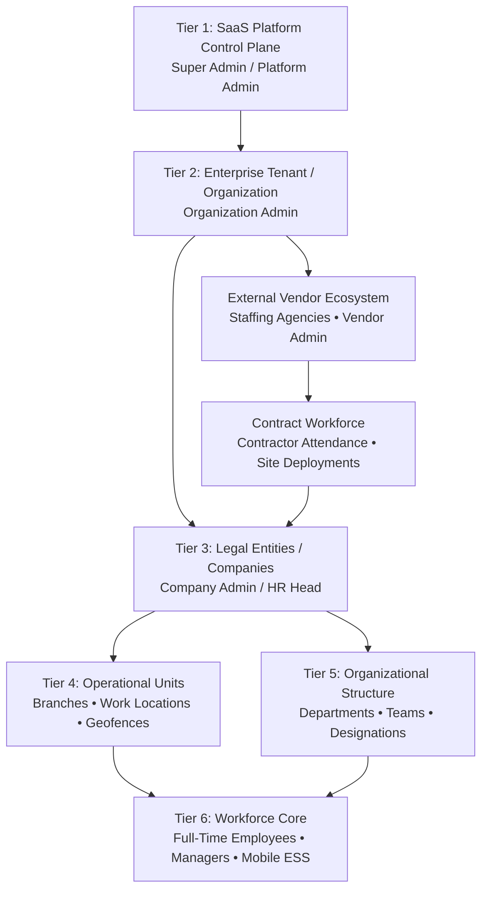

# Joy PeopleHR — Complete SaaS Product & Executive Overview

**Authoritative Technical & Product Dossier**  
**Version:** 1.0.0 (Production Candidate)  
**Date:** September 2026  
**Branding Palette:** Emerald Green (`#07563D` Primary • `#059669` Accent • `#F8F9FA` Surface)  

---

## 1. Product Identity

| Attribute | Verified Value from Codebase |
| :--- | :--- |
| **Product Name** | **Joy PeopleHR** (Internal system package: `workforceos-enterprise-hrms`) |
| **Parent Entity** | **Joy Corporate Solutions Pvt Ltd** / **Joy PeopleHR Technologies** |
| **Product Classification** | Multi-Tenant Enterprise Human Resource Management System (HRMS) & Workforce Operating System |
| **Platform Target** | Web (React 19, TypeScript, TailwindCSS v4, Vite) + Mobile (Flutter 3.x, iOS/Android APK) + Edge IoT (Node.js/TCP Biometric Hardware Connector) |
| **Target Users** | 1. SaaS Platform Super Admins 2. Enterprise Organization & Company HR Heads / Admins 3. Department Managers & Team Leads 4. Full-Time & Contract Employees (Web + Mobile App) 5. Third-Party Manpower Vendors & Staffing Contractors |
| **Primary Market** | India & Regional Emerging Markets (strict adherence to Indian Labor Law, Factories Act 1948, Code on Wages 2019, EPF, ESIC, PT, and CLRA 1970) |
| **Primary Business Problem** | Fragmented workforce management where organizations use separate disconnected tools for core HR, biometric attendance devices, statutory payroll, contract workforce vendors, and employee self-service. |
| **Core Value Proposition** | A unified, single-source-of-truth HRMS combining real-time multi-channel attendance (biometric TCP/IP + mobile geofence + face verification), mathematical statutory payroll calculation, commercial 3-way vendor match, and mobile ESS backed by a hardened Supabase PostgreSQL database. |

---

## 2. Executive 1-Minute Pitch (Presenter Script)

> "Joy PeopleHR is a unified, cloud-native Workforce Operating System built specifically for modern enterprises and multi-unit organizations. Instead of maintaining disjointed systems for payroll, hardware fingerprint machines, leave spreadsheets, and contract staffing agencies, Joy PeopleHR brings the entire employee lifecycle into one single pane of glass.
> 
> From recruitment and digital onboarding to real-time biometric and GPS-geofenced attendance, automated Indian statutory payroll with EPF, ESIC, and Professional Tax, commercial 3-way vendor invoice matching, and a dedicated mobile self-service app for workers—every stage is interconnected with financial-grade audit trails and strict enterprise multi-tenant security."

---

## 3. Executive 3-Minute Deep Dive Pitch (Presenter Script)

> "When managing a modern enterprise workforce, companies face three massive operational bottlenecks:
> 
> First, **Attendance Ingestion Disconnect**: Biometric wall terminals from vendors like eSSL, ZKTeco, and Mantra generate raw punch events that often require manual Excel exports, leading to punch disputes, ghost workers, and delayed payroll processing. Joy PeopleHR solves this with dedicated IoT background connectors that ingest TCP/IP hardware events directly into a normalized database, pairing biometric clock-ins with mobile GPS-geofenced clock-ins and facial verification under a single rule engine.
> 
> Second, **Statutory Payroll Compliance**: Indian payroll is governed by strict compliance mandates—EPF ceilings, ESIC gross thresholds, state-specific Professional Tax slabs, and the Code on Wages 2019 overtime requirements. Joy PeopleHR features an authoritative calculation engine that automatically ingests locked attendance musters, computes dual-tier overtime at 2x rates, applies statutory deductions, and generates verified payslips, bank disbursement files, and EPFO/ESIC-ready ECR schedules with zero manual spreadsheets.
> 
> Third, **Contract Workforce & Vendor Governance**: Most enterprise HRMS platforms completely ignore contract laborers. Joy PeopleHR includes a native Vendor Portal and 3-Way Match Settlement Engine. Contract agencies manage their own deployments, while the enterprise automatically reconciles contractor attendance against Purchase Orders and Vendor Tax Invoices down to the exact man-hour before releasing payment.
> 
> Backed by a high-performance PostgreSQL architecture with 64 canonical tables, Supabase Row-Level Security, and a native Flutter mobile app for iOS and Android, Joy PeopleHR provides full enterprise governance from the boardroom to the factory floor."

---

## 4. SaaS Business Model & Hierarchy

Joy PeopleHR operates on a **True Multi-Tenant SaaS Architecture** structured across 6 hierarchical tiers:

### Tenant Isolation Model
1. **Root Tenant (`organization_id`)**: The top-level enterprise boundary (e.g. `Joy Corporate Solutions`). Multi-company groups share platform billing and policy definitions under a unified umbrella.
2. **Company Boundary (`company_id`)**: Distinct legal entities with separate PAN, GSTIN, PF/ESI establishment codes, bank accounts, and statutory rules.
3. **Branch & Location Boundary (`work_location_id`, `branch_id`)**: Geofenced physical facilities (headquarters, manufacturing plants, technology parks) with assigned biometric terminals and GPS radiuses.
4. **Third-Party Vendor Boundary (`vendor_id`)**: Complete multi-tenant isolation. Staffing vendors can only see their assigned contract personnel, purchase orders, and invoices. They have zero visibility into client direct payroll or other competing vendors.

---

## 5. Core Operational Domains

| Domain | Scope | Live Verification Status |
| :--- | :--- | :--- |
| **People & Core HR** | Employee Directory, 13-step Onboarding Wizard, Employee Profile Drawer, Org Structure, Separation & Exit | **IMPLEMENTED** |
| **Time & Attendance** | Attendance Dashboard, 12 KPI Status Tiles, Employee Attendance Muster, History Ledger, Regularization Desk, Exceptions Queue, Late/Early Tracking | **IMPLEMENTED** |
| **Biometric IoT Gateway** | TCP/IP Socket Adapter (ZKTeco/eSSL), Mantra USB adapter, Edge Agent, Database-First Manual Sync, Sync Health Ledger | **IMPLEMENTED** |
| **Shift & Scheduling** | Shift Master, Multi-shift Rosters, Calendar Matrix, Work Hour & Break Policies | **IMPLEMENTED** |
| **Leave Management** | Multi-type Leave Catalog (CL, SL, PL, Comp-Off), Live Balances, Multi-tier Approval Workflows, Immutable Leave Ledger | **IMPLEMENTED** |
| **Payroll Core** | Authoritative Engine, Salary Structures, Gross-to-Net Math, OT Calculation (Code on Wages), EPF/ESIC/PT/LWF Deductions, Payslips, Bank Files | **IMPLEMENTED** |
| **Vendor Governance** | Dedicated Vendor Portal (`/vendor/login`), Contract Workforce Roster, Purchase Orders, 3-Way Commercial Match, Form V & CLRA Returns | **IMPLEMENTED** |
| **Mobile ESS (Flutter)** | Geofenced Clock-in/out, Real-time Attendance, Leave Requests, Payslip PDF Viewer, Profile, Notifications | **IMPLEMENTED (Native APK Build 6)** |
| **Security & RBAC** | Supabase Auth, PostgreSQL Row-Level Security (RLS), 13 Canonical System Roles, Scope-based Permissions | **IMPLEMENTED** |
| **Asset & Inventory** | Asset Catalog, Serial Allocation, Device Assignment Tracking, Exit Return Clearance | **PARTIALLY IMPLEMENTED (UI + DB)** |
| **Recruitment & ATS** | Job Postings, Requisitions, Applicant Pipeline, Interview Stages | **PARTIALLY IMPLEMENTED (UI + DB)** |
| **Learning (LMS)** | Course Catalog, Enrollments, Mandatory Compliance Training | **PARTIALLY IMPLEMENTED (UI + DB)** |

---

## 6. Competitive Positioning & Neutral Differentiators

Unlike generic HRMS products or standalone payroll SaaS tools, Joy PeopleHR differentiates itself through factual, architecturally proven features:

1. **Hardware-to-Payroll Integration**: Ingests actual device logs from local network biometric hardware (via `node-zklib` edge gateway) directly into Supabase without third-party middleman middleware.
2. **True Contractor 3-Way Match**: Reconciles biometric contractor muster days with enterprise Purchase Order rate cards and Vendor GST Invoices before accounts payable clearance.
3. **Database-Enforced Multi-Tenancy**: All queries enforce `tenant_id` and `company_id` boundaries via PostgreSQL Row-Level Security policies rather than relying purely on client-side React filters.
4. **Klarna-Style Dual Client Architecture**: Features a high-productivity Web Dashboard for HR operations and a lightweight, native Flutter client with off-line tolerance for field and plant employees.
