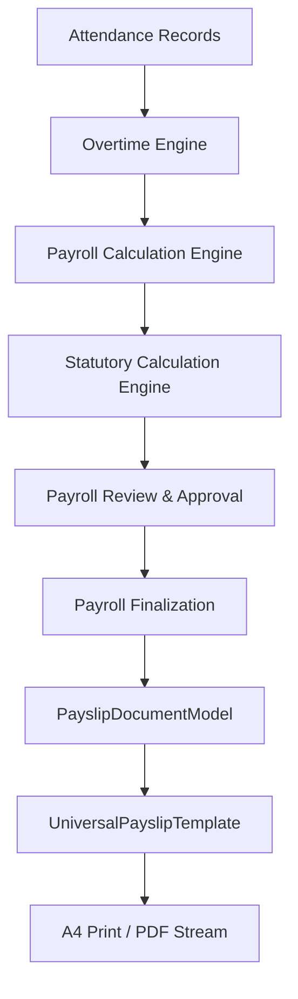

# JOY PeopleHR — Universal Payslip Template Architecture

## Overview & Vision
The **Universal Blue Payslip Template** in JOY PeopleHR is designed to serve diverse workforce archetypes across India—including **factory workers, blue-collar labour, contract workforce, operators, technicians, supervisors, office staff, and corporate management**—without requiring fragmented codebases or manual customization per client.

---

## Key Design & Architectural Principles

### 1. Presentation Layer Only (Zero Independent Calculation)
The payslip is strictly a presentation and document generation layer. It **MUST NEVER calculate payroll independently** (e.g. recalculating Basic, HRA, OT, PF, ESI, PT, LOP, Gross, or Net Pay). 

#### Authoritative Flow:

---

### 2. Multi-Tenant Dynamic Branding
The template dynamically consumes company configurations:
- `company_name` & `legal_name`
- `logo_url`
- `registered_address` & `branch_address`
- `gstin`, `pan`, `cin`
- `pf_establishment_code` & `esi_employer_code`
- `payroll_contact`, `site_hr_phone`, `support_contact`
- `footer_disclaimer` & `authorized_signatory`

---

### 3. Visual Hierarchy & Blue Design System
- **Theme**: Professional Blue (`#034078` Joy Primary Blue, `#0F52BA` Accent Blue, `#0F172A` Slate Dark, crisp neutral borders).
- **Structure**:
  1. **Branded Blue Company Header**: Logo, Company legal identity, address, GSTIN/PAN/PF codes, PAYSLIP badge, and Pay Period.
  2. **Employee Information Grid**: Compact 4-column layout supporting factory details (Shift, Line/Section, Worker Category, Skill Grade, Contractor/Vendor, Masked Bank/PAN/UAN/ESI).
  3. **Attendance & Overtime Summary**: Prominent bar displaying Calendar Days, Present Days, Weekly Off, Paid Holidays, LOP Days, Paid Days, and OT Hours.
  4. **Earnings & Deductions Table**: 2-Column high-contrast comparison with Rate/Units, Current Month, and YTD.
  5. **Statutory Compliance Box**: UAN, PF Number, ESI Number, PAN, PT, PF Wage, ESI Wage.
  6. **Employer Contributions (Informational)**: Clearly separated section for Employer EPF (12%) and Employer ESIC (3.25%).
  7. **Net Take-Home Salary Hero Banner**: Highest contrast banner with Net Disbursed amount and **Amount in Words**.
  8. **Footer & Compliance Disclaimer**: Document ID, generation timestamp, version tag, and non-authentication disclaimer.

---

### 4. Non-Negotiable Financial Invariants
- **Zero-Drift Invariant**:
  $$\text{Net Pay} = \text{Gross Earnings} - \text{Total Employee Deductions}$$
- **Employer Contribution Segregation**:
  Employer PF (12%) and ESIC (3.25%) are displayed strictly as informational items and **NEVER reduce employee Net Pay** or get added to employee deductions.
- **Amount in Words**:
  Dynamically generated from finalized Net Pay using `PayrollRoundingService.amountInWordsINR` (supporting Crores, Lakhs, Thousands, and Paise).

---

### 5. Multi-Archetype Support Matrix

| Feature | Factory / Blue-Collar | Contract Labour | Office Staff | Management |
| :--- | :--- | :--- | :--- | :--- |
| **Attendance Bar** | Prominent (Days, LOP, Present) | Prominent (Days & Shifts) | Standard | Standard |
| **Overtime (OT)** | Dynamic / Fixed OT Hours & Rate | OT Hours & Rate | Optional | Hidden if 0 |
| **Worker Category** | Operator / Technician / Helper | Contract Token & Category | White Collar / Staff | Management |
| **Vendor Attribution** | Direct / Client Site | Contractor / Agency Name | N/A | N/A |
| **Statutory Detail** | PF, ESI, PT, LWF | PF, ESI, PT, LWF | PF, PT, TDS | PF, PT, TDS |
| **Bank Masking** | Partially Masked (`•••• 7192`) | Partially Masked | Partially Masked | Partially Masked |

---

### 6. Printing & PDF Export (A4 Optimization)
- Uses `@media print` with explicit `A4 portrait` dimensions ($194\text{mm}$ max printable width).
- `page-break-inside: avoid` on tables and hero cards prevents broken layout on single-sheet laser and thermal printers.
- Client-side deterministic PDF / HTML export via `UniversalPayslipPdfService`.

---

### 7. File Manifest
- `src/types/payslipViewModel.ts`: Formal TypeScript document model & invariant validator.
- `src/services/payroll/payslipGeneratorService.ts`: Maps finalized payroll records into `PayslipDocumentModel`.
- `src/components/payroll/UniversalPayslipTemplate.tsx`: Universal Blue React template component.
- `src/services/payroll/universalPayslipPdfService.ts`: A4 standalone PDF/HTML export & print engine.
- `src/features/workspace/components/WorkspacePayslipModal.tsx`: Employee self-service payslip viewer.
- `src/features/vendor/subviews/VendorPayslipsView.tsx`: Vendor worker payslip viewer.
- `src/features/payroll/subviews/PayrollSettingsView.tsx`: Payroll admin template customizer & live preview canvas.
- `src/services/__tests__/universalPayslipEngineGate15.test.ts`: Vitest test suite for all 8 archetypes.
