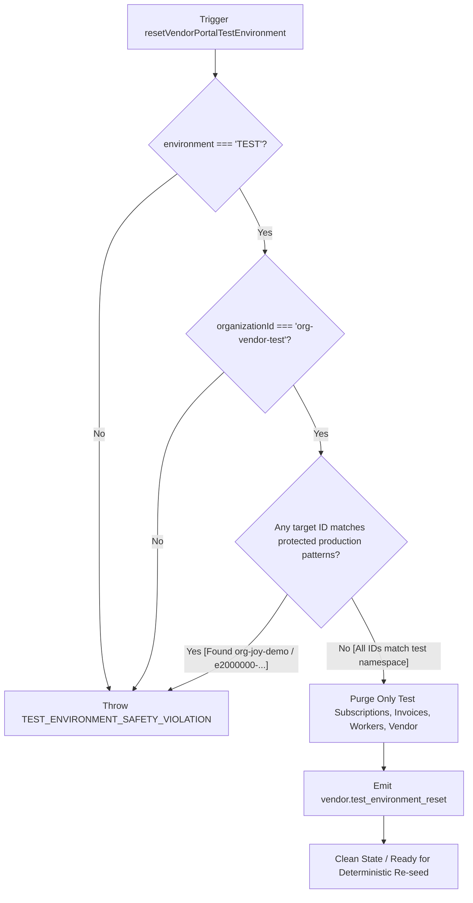

# JOY PEOPLEHR — VENDOR MASTER, CREDENTIAL & MULTI-TENANT ARCHITECTURE
## COMPLETE VISUAL LIFECYCLE, MULTI-COMPANY ISOLATION & DATA FLOW WALKTHROUGH

This document provides complete visual, architectural, and procedural diagrams (ASCII, Mermaid, and SVG-styled flowcharts) detailing the **Company ↔ Vendor Portal** ecosystem.

---

## 1. VENDOR ONBOARDING & CREDENTIAL LIFECYCLE FLOW

```mermaid
sequenceDiagram
    autonumber
    actor CA as Company Admin (Principal Employer)
    participant VS as VendorService
    participant VIS as VendorInvitationService
    participant VCS as VendorCredentialService
    participant EB as HREventBus
    actor VA as Vendor Admin (Contractor)
    participant PAR as PortalAccessResolver
    participant VP as Vendor Portal UI (/vendor/dashboard)

    Note over CA,VP: PHASE 1: VENDOR CREATION & DUPLICATE CHECK
    CA->>VS: createVendor({ legal_name, pan, gstin })
    VS->>VS: checkDuplicateVendor() [PAN, GSTIN, Legal Name]
    alt Duplicate Detected
        VS-->>CA: 409 Conflict: DUPLICATE_VENDOR_DETECTED (Prompt: Attach Relationship)
    else Unique Vendor
        VS->>VS: Generate Next VEN Code ("VEN-000021")
        VS->>EB: emit("vendor.created", { vendor_id, code })
        VS-->>CA: Vendor Master Created (ACTIVE / ONBOARDING)
    end

    Note over CA,VP: PHASE 2: CREDENTIAL INVITATION (24-72h Expiry)
    CA->>VIS: createInvitation({ vendorId, email, role, validityHours: 48 })
    VIS->>VIS: Generate Cryptographic Token (vinv_tok_...) & Expiration
    VIS->>EB: emit("vendor.invited", { token, expires_at })
    VIS-->>VA: Secure Activation Link Delivered (Email/SMS)

    Note over CA,VP: PHASE 3: ACCOUNT ACTIVATION & PASSWORD CREATION
    VA->>VIS: activateAndSetPassword({ token, newPassword })
    VIS->>VIS: Verify Token Not Expired & Valid
    VIS->>VCS: provisionCredentials({ email, password: hash(newPassword) })
    VIS->>EB: emit("vendor.account_activated", { vendor_id })
    VIS-->>VA: Success { redirectUrl: "/vendor/dashboard" }

    Note over CA,VP: PHASE 4: SECURE LOGIN & MULTI-TENANT CONTEXT RESOLUTION
    VA->>VCS: authenticate(email, password)
    VCS->>PAR: resolve({ role: "VENDOR_ADMIN", vendorId })
    PAR-->>VCS: AuthContext { portalType: VENDOR, allowedPortals: [VENDOR], defaultRoute: "vendor-settlement-workspace" }
    VCS-->>VA: Auth Token & Authorized Relationship Scopes
    VA->>VP: Navigate to /vendor/dashboard
```

---

## 2. MULTI-COMPANY RELATIONSHIP ISOLATION ARCHITECTURE

```
+---------------------------------------------------------------------------------------------------------+
|                                    ORGANIZATION: JOY HOLDINGS GROUP                                     |
+---------------------------------------------------------------------------------------------------------+
                                                     |
             +---------------------------------------+---------------------------------------+
             |                                                                               |
             v                                                                               v
+----------------------------------------------------+             +------------------------------------+
|            COMPANY A (JOY CHENNAI PVT LTD)         |             |  COMPANY B (JOY COIMBATORE PVT LTD)|
|  - Entity ID: comp-joy-che                         |             |  - Entity ID: comp-joy-cbe         |
|  - Site: Chennai Unit 1 (Post A)                   |             |  - Site: Coimbatore Industrial     |
|  - Active Labor Capacity: 50 Workers               |             |  - Active Labor Capacity: 25       |
+----------------------------------------------------+             +------------------------------------+
                         |                                                           |
                         | (rel-stream-b-joy-che-01)                                 | (rel-stream-b-joy-cbe-02)
                         | Terms: 8.5% Markup, Net 30                                | Terms: 9.0% Markup, Net 45
                         | Daily Wage: ₹600 / OT: ₹75                                | Daily Wage: ₹650 / OT: ₹80
                         | Capacity: 21 Deployed Guards                              | Capacity: 10 Deployed Guards
                         |                                                           |
                         +-----------------------------+-----------------------------+
                                                       |
                                                       v
                         +-----------------------------------------------------------+
                         |           VENDOR MASTER: ABC SECURITY SERVICES            |
                         |  - Vendor ID: e2000000-0000-0000-0000-01a08496cdfc        |
                         |  - Vendor Code: VEN-000021 (SYSTEM LOCKED)                |
                         |  - GSTIN: 33AABCW1234F1Z5 | PAN: AABCA1234F               |
                         |  - Labor License: LAB-TN-2026-9812 (Exp: 2027-08-31)      |
                         +-----------------------------------------------------------+
                                                       |
                                                       v
                         +-----------------------------------------------------------+
                         |             UNIFIED VENDOR PORTAL SESSION                 |
                         |  - User: ramesh.k@abcsecurity.in (Operations Director)    |
                         |  - Authorized Scopes: [rel-che-01, rel-cbe-02]            |
                         |  - Portal Type: VENDOR ONLY                               |
                         |                                                           |
                         |  SWITCH CUSTOMER RELATIONSHIP:                            |
                         |  [ JOY Chennai (Unit 1) ] <======> [ JOY Coimbatore ]     |
                         |  - Automatic cache flush                                  |
                         |  - Relationship-scoped muster & invoices                  |
                         |  - ZERO cross-company term leakage                        |
                         +-----------------------------------------------------------+
```

---

## 3. 3-WAY COMMERCIAL MATCHING & SETTLEMENT PIPELINE

```
+---------------------+      +----------------------+      +----------------------+
|  BIOMETRIC ATTENDANCE|      |  MASTER WORK ORDER   |      |    VENDOR INVOICE    |
|  August 2026 Muster  |      |   PO-JOY-SEC-2026-001|      |   INV-2026-08-0021   |
|  - 454 Man-Days      |      |   - 21 Headcount     |      |   - Base: ₹3,11,381  |
|  - 194.5 OT Hours    |      |   - ₹600/day + ₹75 OT|      |   - SGST: ₹28,024.5  |
|  - Status: LOCKED 🔒 |      |   - 8.5% Service Fee |      |   - CGST: ₹28,024.5  |
|  - SHA-256 Validated |      |   - Budget: ₹4,00,000|      |   - Total: ₹3,67,430 |
+---------------------+      +----------------------+      +----------------------+
           \                            |                            /
            \                           |                           /
             v                          v                          v
       +-----------------------------------------------------------------+
       |           AUTOMATED 3-WAY COMMERCIAL RECONCILIATION ENGINE      |
       |                                                                 |
       |   Calculated Base Wages:    ₹2,72,400.00                        |
       |   Calculated Overtime:      ₹ 14,587.50                         |
       |   Subtotal:                 ₹2,86,987.50                        |
       |   Service Fee (8.5%):       ₹ 24,393.94                         |
       |   Total Before Tax:         ₹3,11,381.44                        |
       |   GST (18% Total):          ₹ 56,049.00                         |
       |   ------------------------------------------------------------  |
       |   Expected Payable:         ₹3,67,430.00                        |
       |   Claimed Amount:           ₹3,67,430.00                        |
       |   Variance:                 ₹       0.00                        |
       |   Match Result:             MATCHED (100% RECONCILED)           |
       +-----------------------------------------------------------------+
                                        |
                                        v
       +-----------------------------------------------------------------+
       |               COMPANY FINANCE APPROVAL & DISBURSEMENT           |
       |  - Approver: Senthil Nathan (HR & Commercial Compliance)        |
       |  - Mode: Bank NEFT / RTGS to HDFC Bank (A/C: ...7364)           |
       |  - Status: APPROVED -> PAYMENT_PROCESSED                        |
       +-----------------------------------------------------------------+
```

---

## 4. FIELD OWNERSHIP & TAMPER-RESISTANCE ENFORCEMENT

```
+---------------------------------------------------------------------------------------------+
|                           FIELD OWNERSHIP BOUNDARY SPECIFICATION                            |
+---------------------------------------------------------------------------------------------+
|                                                                                             |
|   SYSTEM LOCK LAYER [🔒 IMMUTABLE]                                                          |
|   ---------------------------------------------------------------------------------------   |
|   • vendor_code ("VEN-000021")    ===> Immutable server sequence. Modification throws 403.  |
|   • created_at / created_by       ===> Chronological cryptographic anchor.                  |
|   • id / organization_id          ===> Multi-tenant partition UUID. Cannot be hijacked.     |
|                                                                                             |
|   VENDOR MASTER LAYER [🏢 SHARED IDENTITY]                                                 |
|   ---------------------------------------------------------------------------------------   |
|   • legal_name / trade_name       ===> Owned by Vendor Entity; edits emit audit events.     |
|   • pan / gstin                   ===> Verified once against MCA government registry.       |
|   • contact_email / phone         ===> Managed by Vendor Portal Administrator.              |
|                                                                                             |
|   COMPANY RELATIONSHIP LAYER [💼 COMMERCIAL BOUNDARY]                                       |
|   ---------------------------------------------------------------------------------------   |
|   • service_charge_percentage     ===> Owned exclusively by Principal Employer Finance.     |
|   • max_workforce_capacity        ===> Enforced strictly by Principal Employer Form V.      |
|   • rate_card_type                ===> Commercial contract billing model.                   |
|   • payment_terms                 ===> Credit period (Net 30 / Net 45).                     |
|   • notes / internal_tags         ===> Private company notes, invisible to vendor.          |
|                                                                                             |
+---------------------------------------------------------------------------------------------+
```

---

## 5. DEDICATED VENDOR PORTAL TEST ENVIRONMENT & ISOLATION (GATE 22)

```
┌────────────────────────────────────────────────────────────────────────┐
│                          THREE ISOLATED WORLDS                         │
├──────────────────────────────────┬─────────────────────────────────────┤
│ 1. PRODUCTION / LAUNCH DATA      │ 2. VENDOR TEST ENVIRONMENT          │
│    (IMMUTABLE / NEVER RESET)     │    (DISPOSABLE / DETERMINISTIC)     │
├──────────────────────────────────┼─────────────────────────────────────┤
│ • Org: JOY DEMO GROUP            │ • Org: JOY VENDOR TEST GROUP        │
│   (org-joy-demo)                 │   (org-vendor-test)                 │
│ • Company 1: JOY Chennai Pvt Ltd │ • Company 1: TEST COMPANY CHENNAI   │
│   (comp-joy-che)                 │   (test-company-chennai)            │
│ • Company 2: JOY Coimbatore      │ • Company 2: TEST COMPANY COIMBATORE│
│   (comp-joy-cbe)                 │   (test-company-coimbatore)         │
│ • Vendor: ABC Security Services  │ • Vendor: TEST ABC SECURITY SERVICES│
│   (e2000000-... / VEN-000021)    │   (test-ven-000001)                 │
│ • Real contract workforce (21)   │ • Test vendor workers (8 total)     │
│   ❌ NEVER RESET OR DELETED      │   ✅ FULLY DISPOSABLE & RESETTABLE   │
└──────────────────────────────────┴─────────────────────────────────────┘
                                   │
                                   ▼
┌────────────────────────────────────────────────────────────────────────┐
│ 3. AUTHENTIC VENDOR PORTAL RUNTIME STACK                               │
│    • Real AuthContext (PortalType: VENDOR, role: VENDOR_ADMIN)         │
│    • Real Password & Invitation Token Activation Flow                  │
│    • Customer Switcher: TEST CHENNAI ⟷ TEST COIMBATORE                 │
│    • Relationship-bounded RLS, Realtime Channels & Cache Invalidation  │
└────────────────────────────────────────────────────────────────────────┘
```

### Safety Guard Mechanism



### Gate 22 Certification Suite Summary

- **Tests Executed**: 40 / 40 Passed (100% Green)
- **Coverage**: Tenant isolation, multi-company vendor routing, customer switching, worker isolation, deployment isolation, invoice isolation, URL tampering rejection, RLS enforcement, realtime channel destruction, suspension policies, and production preservation.
- **Suite Command**: `npx tsx src/services/__tests__/vendorPortalEndToEndCertification.test.ts`
- **Master Suite**: `npx tsx src/services/__tests__/runSuite.ts` (All 22 Gates 100% Green)

